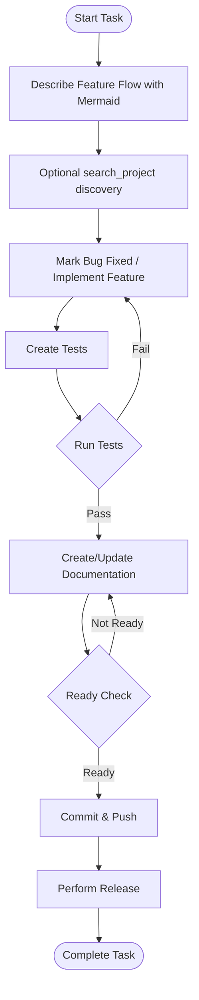

# Product Requirements Document (PRD)

## 1. Overview
- **Product**: Development Workflow MCP Server
- **Prepared by**: Cascade (AI assistant)
- **Date**: 2025-12-27
- **Status**: Live v1.8.0

## 2. Problem Statement
Developers need structured guidance to maintain disciplined workflows across projects. Existing tooling lacks enforcement of sequential best practices (testing, documentation, release hygiene) and offers limited visibility into historical task execution.

## 3. Goals & Objectives
1. Enforce a consistent, auditable development workflow across teams.
2. Provide actionable guidance for each workflow phase within IDE-integrated environments.
3. Maintain per-project, per-user workflow state while supporting shared infrastructure (e.g., SQLite summaries, dashboard).
4. **Support flexible data persistence**: Enable usage of various database backends (MySQL, PostgreSQL, SQLite) to adapt to different hosting and enterprise environments.

## 4. Non-Goals
- Replacing full-featured project management tools.
- Implementing source control hosting or CI/CD pipelines.
- Providing opinionated task estimation or prioritization features.

## 5. Target Users & Personas
- **Individual developers** seeking workflow discipline.
- **Team leads** requiring enforced process compliance.
- **Tool integrators** embedding MCP capabilities into IDEs or agents.

## 6. User Stories
1. As a developer, I want to be guided through the workflow steps so I can avoid skipping critical tasks.
2. As a team lead, I want an auditable history of workflow completion so I can ensure compliance.
3. As an integrator, I want a simple API (tools/prompts) so I can plug the MCP server into existing agent workflows.
4. As a devops engineer, I want to configure the server to use my existing database infrastructure (MySQL/PostgreSQL) instead of local files.
5. As a developer, I want a local read-only search tool that finds relevant lines in my active repository and cites their paths and line numbers.

## 7. Functional Requirements
- Provide MCP tools covering the full workflow lifecycle (start task, fix, test, document, commit, release, complete).
- Persist workflow state per project and per user, with compatibility handling for legacy locations.
- Offer aggregated project summaries (JSON artifacts, Database sync, optional web dashboard).
- Guard release commands to ensure prerequisites are satisfied.
- Require a per-item Definition of Done on every task: `start_task` takes 1-20 items, each item is proven with evidence via `mark_dod_item` or excluded with a written reason via `waive_dod_item`, and ready-check, commit, and complete refuse while any item is open.
- Invalidate stale proof: when new working changes appear after a commit, `dodRevision` increments so previously proven items must be re-confirmed against the code being committed. Waivers survive, because a waiver is a decision rather than a proof.
- Import a Factory task's board checklist as open items on `claim_factory_task`, since a board checkbox records a plan, not local evidence.
- Record `definitionOfDoneSummary` (total, done, waived, open, waived reasons) on every history entry when a task closes.
- Support `run_full_workflow` for scripted execution of all steps with validation.
- Provide search_project for bounded lexical search of the pinned active Git repository. Return sanitized repository-relative path:line citations; honor Git ignore rules and exclude known-sensitive/binary/oversized files; do not persist an index or make network calls.
- Web dashboard displays version dynamically from `package.json` via `/api/version` endpoint to stay in sync after releases.

## 8. Visual Workflow
The complete development workflow is documented visually using Mermaid:
- [View Mermaid Diagram](file:///d:/code/dev-workflow-mcp-server/docs/mermaid/feature-flow.mmd)

- [x] **Consolidated CI/CD**: Unified release and publish workflows.
- [x] **Multi-Database Support**: SQLite, MySQL, and PostgreSQL adapters implemented and verified.
- [x] **Environment Configuration**: `.env` file support added.
- [x] **Comprehensive Testing**: Automated tests for DB adapters and environment loading.
- [x] **Modular Architecture**: Refactored handlers.js into focused handler modules for better maintainability.
- [x] **Test Organization**: Split monolithic test file into focused test modules with shared utilities.
- [x] **PRD Location**: Moved PRD.md to docs/ root for easier access.
- **Multi-Database Support**: Abstract the storage layer to support:
    - SQLite (default/local)
    - MySQL
    - PostgreSQL

## 8. Technical Considerations
- Node.js (ESM) codebase leveraging `@modelcontextprotocol/sdk`.
- File-based state stored under `.state/users/<user>/workflow-state.json` with compatibility symlinks.
- **Database Abstraction**: Implement an Adapter/Repository pattern or use an ORM (e.g., Knex, Prisma, Drizzle) to support multiple SQL dialects.
- Vite build pipeline for distribution bundle; source usage recommended for MCP.
- Windows compatibility requirements (Python, Build Tools for native modules).
- **Deployment options**: Local development, Netlify (static), Plesk (full-featured).

## 9. Success Metrics
- ≥90% of workflow operations executed via MCP tools (vs. manual overrides).
- Reduction in release guard violations to <5% of attempts.
- Positive qualitative feedback on guidance clarity from pilot teams.
- Seamless switching between SQLite, MySQL, and PostgreSQL via configuration.

## 10. Milestones
1. **MVP**: Core workflow tools, state persistence, basic history (complete).
2. **Enhancements**: Improved project root detection, compatibility mirrors, `run_full_workflow` automation (complete).
3. **v1.5.0**: Netlify deployment support for static web dashboard (complete).
4. **v1.6.0+**: Dark/Light mode, UI Improvements (complete).
5. **Multi-Database Support**: Refactor storage layer to support MySQL and PostgreSQL (complete v1.7.1).
7. **v1.7.14 Performance & Resilience**: Implemented connection timeouts and optimized startup sequence for stdio clients (complete).
8. **v1.7.15 Schema Alignment**: Implemented Postgres/MySQL column normalization and automated integer User ID hashing for cross-dashboard compatibility (complete).
9. **v1.8.1 Mermaid Feature Flow**: Integrated visual planning tool and stabilized core workflow logic (complete).
10. **Future**: Expanded dashboard analytics, customizable workflows, richer integrations.

## 11. Risks & Mitigations
- **Risk**: Workflow feels overly prescriptive. **Mitigation**: Provide escape hatches (`force_complete_task`, `drop_task`) with audit trails.
- **Risk**: State corruption due to concurrent access. **Mitigation**: File locking and defensive JSON parsing (existing code handles gracefully, but monitor).
- **Risk**: Integration friction with IDE clients. **Mitigation**: Maintain detailed README instructions and example configurations.
- **Risk**: Complicated setup for users not needing external DBs. **Mitigation**: Keep SQLite/File-system as the default zero-config option.

## 12. Open Questions
- Should additional workflow phases (e.g., design review) be supported?
- How should multi-branch workflows be represented in history summaries?
- What telemetry or analytics are acceptable within privacy constraints?

## 13. Addendum — 3.3.0 post-release verification (2026-11-26)

- Registry version 3.3.0 and `dist.shasum` `8af0aba1b7f1b3d44b123747597cd8dd6382eb7a` matched the local pack.
- Annotated `v3.3.0` tag pushed at `385f5e4909c1338370a8086d3c4671f98c1c6381` with a GitHub Release using `docs/release-notes/RELEASE_NOTES.md`.
- Published tarball: 255 files, no `state/` or `user-id`, no unexpected email addresses, gitleaks clean.
- Global install: `devwf --version` 3.3.0 and `devwf doctor` OK; npm 11+/12 needs a user-level `allow-scripts` entry for `better-sqlite3` plus a one-off `--allow-scripts` reinstall, verified by a fresh flagless global install.
- Stdio MCP: 18 / 30 / 66 tools for core / standard / full, out-of-profile calls rejected, Context cost line present, `devwf tools --tokens` verified.
- Old `@programinglive/dev-workflow-mcp-server` 1.29.2–1.32.8 deprecated with the full notice; 3.2.0 and later untouched.
- Central release host promoted to 3.3.0; bootstrap and prewarm resolved on HELLOWORLD, Mac and MMCH; managed rule block present in all nine AI CLI files.
