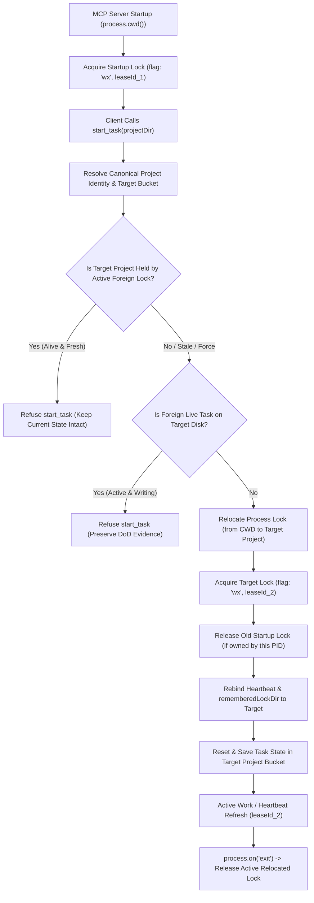

# DevWorkflow MCP — Project Lock & Session Isolation Architecture Specification

- **Document ID:** `DEVWF-DES-2026-11-14-01`
- **Canonical DevWorkflow Task:** `8feef683-f09a-4d2c-9cda-0b91da603a10`
- **Zettly Tracking:** Todo `#756` | Focus `#81` | Draw `#398` / `#400`
- **Implementation Branch:** `fix/project-lock-session-isolation`
- **Target Component:** `workflow-state.js`, `process-lock.js`, `tools/handler-modules/workflow-handlers.js`, `index.js`

---

## 1. Architectural Overview & Objective

DevWorkflow MCP enforces the strict governance invariant:
> **One Active Writer per Working Tree** — preventing silent edit overwrites, race conditions, and Definition-of-Done destruction across multiple sessions or AI clients.

This specification details the permanent design that guarantees:
1. **Startup Working Directory Decoupling:** Multiple AI agents (Antigravity, Codex, OpenCode) launching from a shared root (e.g. `C:\Users\mahardhika`) do not falsely collide when targeting separate projects.
2. **Canonical Project Identity Pre-Resolution:** Canonical project paths and bucket directories are resolved *before* validating project locks or evaluating disk states.
3. **Atomic Lock Operations:** All lock acquisitions, stale takeovers, and corrupt file recoveries use OS-level atomic filesystem operations (`flag: "wx"`, atomic compare-owner tombstone rename).
4. **Lease Token Fencing:** Every lock acquisition or relocation generates a unique cryptographically random, monotonic `leaseId`. Heartbeat refreshes and releases are strictly fenced to the active lease token.
5. **Dynamic Lock Relocation:** When a task starts with an explicit target `projectDir`, the process lock and heartbeat target dynamically migrate from startup CWD to the target project bucket. If the startup lock was held by the current process, it is cleanly released.
6. **Robust Cross-Platform Holder Verification:** Windows process verification queries `tasklist` to detect PID reuse by non-Node processes.

---

## 2. Lock State Transition Model



---

## 3. Core Subsystem Specifications

### 3.1 Canonical Project Identity Resolver (`workflow-state.js`)

#### 3.1.1 Path Normalization Rules
`canonicalProjectPath(candidate)` performs cross-platform path canonicalization:
1. Trims whitespace and strips null bytes.
2. Resolves relative paths via `path.resolve()`.
3. Resolves symlinks and Windows directory junctions via `fs.realpathSync.native()` when the directory exists on disk.
4. Normalizes path separators and strips trailing slashes (except root).
5. Enforces uppercase drive letters on Windows (e.g. `C:\...`).

#### 3.1.2 Target Project State Pre-Resolution
`resolveTargetProjectState({ stateFile, projectDir })`:
Given a startup `stateFile` in `.state/projects/<startup-bucket>/users/...` and a target `projectDir`:
- Computes `bucketKey = projectKey(canonicalTarget)`.
- Derives `targetStateFile = <baseDir>/projects/<bucketKey>/users/<user>/workflow-state.<sessionKey>.json`.
- Identifies `projectDirPath = <baseDir>/projects/<bucketKey>`.
- Allows `handleStartTask` to query `targetLockDir = projectLockDir(targetStateFile)` without mutating disk or memory state.

#### 3.1.3 Multi-Session Foreign Live Task Inspection
`findActiveForeignTaskInProject({ projectDirPath, targetStateFile, ownPid, now, staleMs, isAlive })`:
- Scans `targetStateFile`, root `workflow-state.json`, and all sibling session state files in `projectDirPath/users/*`.
- Detects whether any active live task (`phase !== "idle" && description !== ""`) is currently owned by an active foreign PID with fresh heartbeat (`updatedAt < 10m`).
- Blocks `start_task` even if `force: true` is passed, protecting uncompleted Definitions of Done from destruction.

---

### 3.2 Atomic Lock Acquisition & Recovery (`process-lock.js`)

#### 3.2.1 Atomic Creation via `flag: "wx"`
```javascript
const payload = { pid, leaseId: effectiveLeaseId, startedAt: now, heartbeatAt: now, host };
writeFileSync(lockFile, JSON.stringify(payload), { encoding: "utf8", flag: "wx" });
```
- If the file does not exist, `flag: "wx"` atomically creates it in kernel space. No other process can interleave.
- If the file exists, the call throws `EEXIST`, triggering detailed inspection (`readProcessLockDetailed`).

#### 3.2.2 Atomic Stale / Corrupt Takeover via Tombstone Rename
When a lock file is corrupt or held by a dead / stale PID:
```javascript
function tryClaimStaleOrCorruptLock(lockFile, expectedHolder) {
  const tombstone = `${lockFile}.tomb.${process.pid}.${Date.now()}-${Math.random().toString(16).slice(2, 8)}`;
  try {
    renameSync(lockFile, tombstone);
    try { unlinkSync(tombstone); } catch {}
    return true;
  } catch {
    return false; // Another concurrent process won the atomic rename
  }
}
```
- The atomic rename (`renameSync`) guarantees that among $N$ concurrent processes attempting recovery, exactly one wins.
- Losers safely retry the acquisition loop to inspect the winner's new lock.

---

### 3.3 Dynamic Lock Relocation Protocol

When moving from `currentLockDir` to `targetLockDir`:
```javascript
export function relocateProcessLock({ fromDir, toDir, pid = process.pid, force = false, ... }) {
  if (path.resolve(fromDir) === path.resolve(toDir)) {
    // Same directory: simply refresh or re-acquire
    return { ok: true, sameDir: true };
  }
  // Step 1: Acquire target lock atomically with new lease token
  const targetAcquire = acquireProcessLock({ dir: toDir, pid, force, remember: true, ... });
  if (!targetAcquire.acquired) {
    return { ok: false, holder: targetAcquire.holder };
  }
  // Step 2: Release previous lock only if owned by this process and active lease matches
  if (fromDir) {
    releaseProcessLock({ dir: fromDir, pid, preserveRemembered: true });
  }
  return { ok: true, leaseId: targetAcquire.leaseId };
}
```
- If target lock acquisition fails, the startup lock remains active and unchanged.
- If target lock acquisition succeeds, the startup lock is unlinked only if owned by our PID, freeing the shared CWD for other processes.

---

### 3.4 Lease Token Fencing Against Delayed Timers

1. **Lease Generation:** `generateLeaseId(pid, now)` produces `lease-<pid>-<now>-<random8>`.
2. **Heartbeat Fencing:** `refreshProcessLock({ dir, pid, leaseId })`:
   - Compares lock file's `pid` and `leaseId`.
   - If `existing.leaseId !== rememberedLease.leaseId`, the heartbeat refresh is denied.
   - An outdated or desynchronized timer can never mutate a newly relocated lock or foreign owner's lock.

---

### 3.5 Clean Shutdown Protocol (`index.js`)

At process initialization:
```javascript
const lockDir = projectLockDir(workflowState.stateFile);
acquireProcessLock({ dir: lockDir });
process.once('exit', () => releaseActiveProcessLock({ fallbackDir: lockDir }));
```
`releaseActiveProcessLock({ fallbackDir })`:
- Reads `rememberedLockDir` (which points to the relocated target directory if relocation occurred).
- If relocation never occurred, falls back to `fallbackDir`.
- Releases the lock only if `existing.pid === process.pid` and `existing.leaseId === rememberedLockLease.leaseId`.

---

## 4. Verification Matrix

| Requirement | Design Solution | Test Verification |
| :--- | :--- | :--- |
| Decouple shared startup CWD | `resolveTargetProjectState` pre-resolution | Scenario A, F, I |
| Mutual exclusion on target project | Atomic `flag: "wx"` on target bucket | Scenario B |
| Clean lock migration | `relocateProcessLock` | Scenario C |
| Safe failure on held target | Atomicity check + unchanged startup lock | Scenario D |
| Crash & PID reuse recovery | Tombstone rename + `defaultIsHolderProcess` | Scenario E |
| Lease token fencing | Monotonic `leaseId` check in heartbeat/release | Scenario H |
| Backward compatibility | Normalized `projectKey` & bucket resolution | Scenario G |
| Multi-process CLI validation | Child processes executing CLI `start_task` | Scenario I |
| R2-1 Gate recovery safety | Fail-closed `LOCK_GATE_ABANDONED` + explicit `recoverAbandonedLockGate` under `mcp-process.gate.recover.lock` | R2-1 (two-process IPC barrier) |
| R2-2 Async reentrant release | Unified `releaseGateEntry` on `entry.count === 0` | R2-2 (out-of-order inner/outer async release) |
| R2-3 Async execution-context isolation | `AsyncLocalStorage` (`gateExecutionStorage` & `serializedExecutionStorage`) + `inProcessGateQueues` | R2-3 (concurrent Request A & Request B at `await`) |
| R2-4 Durable transition & crash recovery | `<base>/sessions/transition-<sessionKey>.journal.json` + `markTransitionJournalCommitted` + `rollbackTransitionJournal` + `reconcilePendingTransitionJournals` | R2-4 (post-save failure + `SIGKILL` crash recovery) |
| R2-5 Legacy exclusion & fleet quiescence | Unconditional `<base>/projects/*/mcp-process.lock` scan + `verifyLegacyFleetQuiescence` | R2-5 (missing/outdated session pointer + quiescence gate) |
| R3-1 Trusted recovery authority | Unforgeable `WeakSet` capability (`mintTrustedGateRecoveryAuthority` under `DEVWF_OPERATOR_GATE_RECOVERY=1`) + fail-closed `recovery_lock_abandoned` | R3-1 (boolean rejection + dead recover lock) |
| R3-2 Atomic link publication | Removed `writeFileSync(..., { flag: "wx" })` fallback; throws `UNSUPPORTED_ATOMIC_LINK` | R3-2 (atomic link enforcement) |
| R3-3 Async capability lifetime | Epoch-scoped capability invalidated on exit in `runSerialized` & `withLockGate` | R3-3 (detached child C vs active B) |
| R3-4 / R3-5 Journal recovery & persistence | Exclusive `.recover.lock`, `transitionJournalId` fencing, no `history`/`project_summary` clobber, fail-closed write/commit/cleanup | R3-4 & R3-5 (barrier, newer owner, crash, commit fail) |
| R3-6 Legacy admission barrier | Fail-closed `EACCES` inspection + `maintenance-admission.json` (`acquireMaintenanceAdmissionBarrier`) | R3-6 (`EACCES` quiescence + barrier) |
| Option B OS-Owned Kernel Mutex | `acquireWorktreeMutex`, `WorktreeMutexCapability`, `useWorktreeCapability`, `writeKernelLockMetadata` (`net.createServer` exclusive Windows Named Pipe / Linux abstract socket; `darwin` fails closed unless `DEVWF_ALLOW_UNVERIFIED_MUTEX=1` allows the unverified unix socket endpoint) | Option B two-process `SIGKILL` & kernel-exclusion tests |

---

## 6. Approved Option B: OS-Owned Kernel Mutex Integration

- **OS-Level Process-Lifetime Exclusion (`acquireWorktreeMutex`):**
  - Windows (`win32`): `\\.\pipe\devwf-wt-<sha256(canonicalWorktreeRoot).slice(0, 32)>` (`exclusive: true`)
  - Linux (`linux`): `\0devwf-wt-<sha256(canonicalWorktreeRoot).slice(0, 32)>` (abstract Unix domain socket, `exclusive: true`)
  - macOS (`darwin`): Blocked by default (`unsupported_platform`); admission fails closed until a native OS-owned primitive is implemented and verified.
    - **Explicit opt-in (`DEVWF_ALLOW_UNVERIFIED_MUTEX=1`):** the operator may allow a best-effort endpoint on macOS. The endpoint is a unix domain socket file named `devwf-wt-<sha256(canonicalWorktreeRoot).slice(0, 32)>.sock` inside `~/.devwf`, so two different worktrees never share one endpoint and the endpoint is never a TCP port. Because it is a file and not an OS kernel object, its exclusivity is **unverified**: the process prints `WARNING: kernel mutex unverified on darwin; enabled by DEVWF_ALLOW_UNVERIFIED_MUTEX=1` once per process. Only the exact value `1` activates it; every other value, including an empty one, keeps the fail-closed refusal. A socket file left behind by a killed process is reclaimed only after a connection to it is refused, which proves that no live owner is bound to it. `DEVWF_MUTEX_SOCKET_DIR` overrides the socket directory for tests.
- **macOS consequence without the opt-in:** every workflow write fails closed on macOS, because the write path requires the kernel capability. A Mac that cannot write workflow state never reports to the central monitor, so the fleet view keeps showing a stale machine row.
- **Automatic `SIGKILL` Cleanup:** Because the kernel closes the pipe/socket handle immediately on process termination, a successor process acquires the mutex cleanly without abandoned-gate deadlocks or pathname-rename races.
- **Entrypoints:** [index.js](file:///D:/code/dev-workflow-mcp-server/index.js) (both MCP server `main()` and CLI `cliMain()`) enables `requireKernelMutex: true` and binds the startup `WorktreeMutexCapability`. `handleStartTask` in [workflow-handlers.js](file:///D:/code/dev-workflow-mcp-server/tools/handler-modules/workflow-handlers.js) acquires the target worktree capability directly via `acquireWorktreeMutex`, binds it to `WorkflowState`, and fences all persistence operations through `useWorktreeCapability`. `releaseWorktreeMutex` drains in-flight operations and closes the held kernel mutex.

---

## 7. DevWorkflow v2.1.2: Zero-Dangling-Locks Lifecycle & Safe Takeover Hardening

### 7.1 Clean Mutex Release on Task Termination
- In previous versions (`<= v2.1.1`), `handleCompleteTask`, `handleDropTask`, and `handleForceCompleteTask` called `workflowState.reset()` without calling `releaseWorktreeMutex()` or unbinding the kernel capability from the process registry. As a result, long-running MCP processes held onto the OS named pipe / socket endpoint even after a task had completed, blocking successor sessions or concurrent test runs.
- In `v2.1.2`, all terminal handlers explicitly:
  1. Durably save the completed/dropped state under the live capability fence.
  2. Call `releaseWorktreeMutex(activeCap)` to drain in-flight operations and close the server socket/pipe.
  3. Unbind the capability via `workflowState.bindKernelCapability(null)`.
  4. Reset the in-memory state and persist the idle state with `{ allowOrphanedReset: true }`.

### 7.2 Safe Re-Acquisition Across Server Restarts
- In `useSession(sessionId)`, when an active session (`currentPhase !== 'idle'`) is loaded by a newly spawned or restarted MCP server process where in-memory capability is not yet bound, the server attempts safe re-acquisition via `acquireWorktreeMutex({ projectDir, ownerKey: sessionKey, timeoutMs: 0 })`.
- If the former process is dead, the OS pipe endpoint is free and the new process safely takes over the worktree mutex. If another live process is still running, the acquisition fails closed without corrupting state.

### 7.3 Scoped Orphaned Idle Save Enforcement
- `WorkflowState.prototype.save` permits orphaned saves without requiring a live kernel capability **only** when `currentPhase === "idle" && !this.boundKernelCapability && !options?.allowReplaceRunningTask`. This allows post-termination outbox flushes and idle resets to persist cleanly while continuing to strictly fail closed if an invalid or ownerless capability is bound during active task phases.


---

## 5. Round 2 Concurrency & Durability Hardening (`R2-1` – `R2-5`)

### 5.1 R2-1: Fail-Closed Gate Acquisition & Controlled Abandoned-Gate Recovery
- **Elimination of Pathname Recovery Races in Normal Acquisition:** `acquireLockGate` **never** calls `renameSync` or `unlinkSync` on an existing `mcp-process.gate.lock`. If the recorded gate holder process is confirmed dead (or the gate remains unreadable past `gateCorruptGraceMs`), `acquireLockGate` fails closed and returns `{ acquired: false, error: "LOCK_GATE_ABANDONED", abandoned: true, holder }`.
- **Controlled Operator-Authorized Recovery (`recoverAbandonedLockGate`):** Recovery of an abandoned gate requires an explicit call to `recoverAbandonedLockGate({ dir, expectedToken, authorizeAbandonedGateRecovery: true })`:
  1. Enforces `authorizeAbandonedGateRecovery === true` and a non-empty `expectedToken` matching the abandoned gate's `gateToken`.
  2. Acquires an exclusive recovery mutex file `mcp-process.gate.recover.lock` (`GATE_RECOVER_FILENAME`) via `publishCompleteJsonFile`. Normal `acquireLockGate` yields while `mcp-process.gate.recover.lock` is held by a live recovery process.
  3. Re-reads `mcp-process.gate.lock` inside the recovery lock, re-verifies `existing.gateToken === expectedToken`, confirms the holder is dead, and only then renames `mcp-process.gate.lock` to a tombstone and unlinks it. A delayed second recovery process sees `gate_token_mismatch` and cannot affect a successor's newly acquired gate.

### 5.2 R2-2 & R2-3: Execution-Context-Scoped Async Ownership & Last-Holder Gate Cleanup
- **`AsyncLocalStorage` Execution Context Scoping:**
  - `process-lock.js` uses `gateExecutionStorage = new AsyncLocalStorage()` instead of a process-wide `Map` for re-entrancy detection. `acquireLockGate` and `withLockGate` recognize a call as re-entrant **only** if `gateExecutionStorage.getStore()?.get(resolvedDir)` is present in the caller's async execution chain and its `entry.closed === false`.
  - `workflow-state.js` uses `serializedExecutionStorage = new AsyncLocalStorage()` in `WorkflowState.prototype.runSerialized(fn)` instead of an instance-wide `this._inSerializedOp` counter. Independent requests arriving while an operation is suspended at an `await` never bypass `this._opQueue` or `inProcessGateQueues`.
- **Last-Holder Gate Release (`releaseGateEntry`):**
  - Both outer (`reentrant: false`) and nested (`reentrant: true`) gate handles invoke `releaseGateEntry(resolvedDir, entry)` with an idempotent per-handle guard.
  - When any handle releases, `entry.count` is decremented (`entry.count -= 1`). When and only when `entry.count === 0` (the last valid holder in the execution tree exits), `entry.closed = true` is set and `mcp-process.gate.lock` is verified by `gateToken` and unlinked.

### 5.3 R2-4: Durable Transition Journal, Authoritative Commit Point, and Crash Recovery
- **Pre-Mutation Durable Journal (`beginTransitionJournal`):** Before `handleStartTask` mutates session pointers, focus bindings, or target/source state files, it writes a durable transition journal to `<base>/sessions/transition-<sessionKey>.journal.json` containing:
  - `status: "pending"`
  - Pre-transition snapshots of source and target JSON files (`sourceStateSnap`, `targetStateSnap`, `targetHistorySnap`, `targetSummarySnap`)
  - Pre-transition SQLite row snapshots (`sourceDbSnapshot` and `targetDbSnapshot` read from `workflow.db`)
  - `priorSessionPointer`, `priorFocusBinding`, and `stagedLock` metadata (`fromDir`, `toDir`, `targetLease`, `priorLease`).
- **Explicit Authoritative Commit Point:**
  - After `workflowState.save({ allowReplaceRunningTask: true })` and optional `afterSave` verification complete, `handleStartTask` reaches the single authoritative commit point:
    1. `markTransitionJournalCommitted(transitionJournal)` atomically persists `status: "committed"` to the journal file.
    2. `commitProcessLockTransition(stagedLock)` releases the prior startup/source project lock lease and binds the target project lease.
    3. `completeTransitionJournal(transitionJournal)` removes the completed journal file.
- **Post-Save Rollback & Automatic Restart Reconciliation:**
  - If any error is thrown before `markTransitionJournalCommitted` (including after `workflowState.save()` has already written to `targetStateFile` and target `workflow.db`), `rollbackTransitionJournal` restores **both** the target project (`targetDbSnapshot`, `targetStateSnap`, `targetHistorySnap`, `targetSummarySnap`) and the source project (`sourceDbSnapshot`, `sourceStateSnap`), restores `priorSessionPointer` and `priorFocusBinding`, and rolls back `stagedLock` so zero phantom tasks or locks remain in `targetLockDir`.
  - If a process crashes (`SIGKILL`) before `markTransitionJournalCommitted`, the next process calling `resolveStateFile` (`reconcilePendingTransitionJournalsSync`) or `WorkflowState.load()` (`reconcilePendingTransitionJournals`) detects the orphaned `status: "pending"` journal whose `pid` is no longer alive (or is the current recovering session) and deterministically rolls back all uncommitted target/source artifacts before serving state.

### 5.4 R2-5: Full-Root Legacy Writer Exclusion & Fleet Quiescence Verification
- **Unconditional Shared-Root Legacy Lock Scan (`detectIncompatibleLegacyWriters`):**
  - Because legacy v1 processes (which write `mcp-process.lock` without `leaseId` or `protocolVersion: 2`) may run in an unpinned startup bucket without ever creating `<base>/sessions/<sessionId>.json`, or may have an outdated session pointer pointing to a previous repository, `detectIncompatibleLegacyWriters` unconditionally enumerates **all** `<base>/projects/*/mcp-process.lock` files whenever `toDir` is inside a `.state/projects/<bucket>` layout (in addition to scanning `<base>/sessions/*.json` and foreign state files in `toDir`).
  - Any live legacy v1 lock anywhere under `<base>/projects/*` causes `acquireProcessLock`, `stageProcessLockTransition`, and `handleStartTask` to fail closed with `reason: "legacy_writer_active"`.
- **Pre-Cutover Fleet Quiescence Verifier (`verifyLegacyFleetQuiescence`):**
  - Scans `<base>/projects/*` and `<base>/sessions/*` and reports `{ quiescent, legacyWriters, abandonedGates, pendingJournals }` so release automation or operators can verify zero active legacy v1 processes, zero abandoned gates, and zero pending transition journals before or after fleet cutover.
