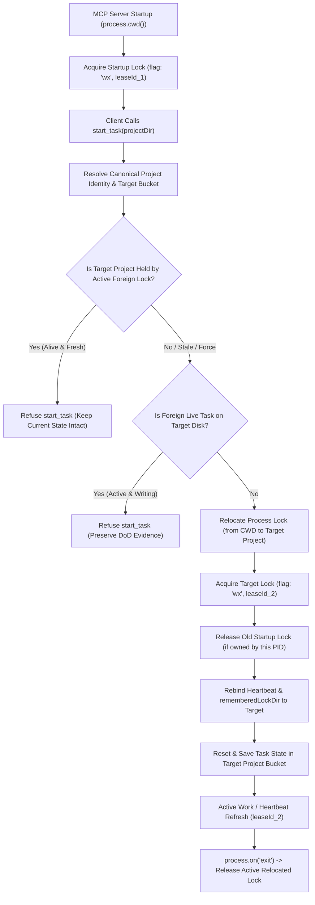

# DevWorkflow MCP — Project Lock & Session Isolation Architecture Specification

- **Document ID:** `DEVWF-DES-2026-11-14-01`
- **Canonical DevWorkflow Task:** `8feef683-f09a-4d2c-9cda-0b91da603a10`
- **Zettly Tracking:** Todo `#756` | Focus `#81` | Draw `#398` / `#400`
- **Implementation Branch:** `fix/project-lock-session-isolation`
- **Target Component:** `workflow-state.js`, `process-lock.js`, `tools/handler-modules/workflow-handlers.js`, `index.js`

---

## 1. Architectural Overview & Objective

DevWorkflow MCP enforces the strict governance invariant:
> **One Active Writer per Working Tree** — preventing silent edit overwrites, race conditions, and Definition-of-Done destruction across multiple sessions or AI clients.

This specification details the permanent design that guarantees:
1. **Startup Working Directory Decoupling:** Multiple AI agents (Antigravity, Codex, OpenCode) launching from a shared root (e.g. `C:\Users\mahardhika`) do not falsely collide when targeting separate projects.
2. **Canonical Project Identity Pre-Resolution:** Canonical project paths and bucket directories are resolved *before* validating project locks or evaluating disk states.
3. **Atomic Lock Operations:** All lock acquisitions, stale takeovers, and corrupt file recoveries use OS-level atomic filesystem operations (`flag: "wx"`, atomic compare-owner tombstone rename).
4. **Lease Token Fencing:** Every lock acquisition or relocation generates a unique cryptographically random, monotonic `leaseId`. Heartbeat refreshes and releases are strictly fenced to the active lease token.
5. **Dynamic Lock Relocation:** When a task starts with an explicit target `projectDir`, the process lock and heartbeat target dynamically migrate from startup CWD to the target project bucket. If the startup lock was held by the current process, it is cleanly released.
6. **Robust Cross-Platform Holder Verification:** Windows process verification queries `tasklist` to detect PID reuse by non-Node processes.

---

## 2. Lock State Transition Model



---

## 3. Core Subsystem Specifications

### 3.1 Canonical Project Identity Resolver (`workflow-state.js`)

#### 3.1.1 Path Normalization Rules
`canonicalProjectPath(candidate)` performs cross-platform path canonicalization:
1. Trims whitespace and strips null bytes.
2. Resolves relative paths via `path.resolve()`.
3. Resolves symlinks and Windows directory junctions via `fs.realpathSync.native()` when the directory exists on disk.
4. Normalizes path separators and strips trailing slashes (except root).
5. Enforces uppercase drive letters on Windows (e.g. `C:\...`).

#### 3.1.2 Target Project State Pre-Resolution
`resolveTargetProjectState({ stateFile, projectDir })`:
Given a startup `stateFile` in `.state/projects/<startup-bucket>/users/...` and a target `projectDir`:
- Computes `bucketKey = projectKey(canonicalTarget)`.
- Derives `targetStateFile = <baseDir>/projects/<bucketKey>/users/<user>/workflow-state.<sessionKey>.json`.
- Identifies `projectDirPath = <baseDir>/projects/<bucketKey>`.
- Allows `handleStartTask` to query `targetLockDir = projectLockDir(targetStateFile)` without mutating disk or memory state.

#### 3.1.3 Multi-Session Foreign Live Task Inspection
`findActiveForeignTaskInProject({ projectDirPath, targetStateFile, ownPid, now, staleMs, isAlive })`:
- Scans `targetStateFile`, root `workflow-state.json`, and all sibling session state files in `projectDirPath/users/*`.
- Detects whether any active live task (`phase !== "idle" && description !== ""`) is currently owned by an active foreign PID with fresh heartbeat (`updatedAt < 10m`).
- Blocks `start_task` even if `force: true` is passed, protecting uncompleted Definitions of Done from destruction.

---

### 3.2 Atomic Lock Acquisition & Recovery (`process-lock.js`)

#### 3.2.1 Atomic Creation via `flag: "wx"`
```javascript
const payload = { pid, leaseId: effectiveLeaseId, startedAt: now, heartbeatAt: now, host };
writeFileSync(lockFile, JSON.stringify(payload), { encoding: "utf8", flag: "wx" });
```
- If the file does not exist, `flag: "wx"` atomically creates it in kernel space. No other process can interleave.
- If the file exists, the call throws `EEXIST`, triggering detailed inspection (`readProcessLockDetailed`).

#### 3.2.2 Atomic Stale / Corrupt Takeover via Tombstone Rename
When a lock file is corrupt or held by a dead / stale PID:
```javascript
function tryClaimStaleOrCorruptLock(lockFile, expectedHolder) {
  const tombstone = `${lockFile}.tomb.${process.pid}.${Date.now()}-${Math.random().toString(16).slice(2, 8)}`;
  try {
    renameSync(lockFile, tombstone);
    try { unlinkSync(tombstone); } catch {}
    return true;
  } catch {
    return false; // Another concurrent process won the atomic rename
  }
}
```
- The atomic rename (`renameSync`) guarantees that among $N$ concurrent processes attempting recovery, exactly one wins.
- Losers safely retry the acquisition loop to inspect the winner's new lock.

---

### 3.3 Dynamic Lock Relocation Protocol

When moving from `currentLockDir` to `targetLockDir`:
```javascript
export function relocateProcessLock({ fromDir, toDir, pid = process.pid, force = false, ... }) {
  if (path.resolve(fromDir) === path.resolve(toDir)) {
    // Same directory: simply refresh or re-acquire
    return { ok: true, sameDir: true };
  }
  // Step 1: Acquire target lock atomically with new lease token
  const targetAcquire = acquireProcessLock({ dir: toDir, pid, force, remember: true, ... });
  if (!targetAcquire.acquired) {
    return { ok: false, holder: targetAcquire.holder };
  }
  // Step 2: Release previous lock only if owned by this process and active lease matches
  if (fromDir) {
    releaseProcessLock({ dir: fromDir, pid, preserveRemembered: true });
  }
  return { ok: true, leaseId: targetAcquire.leaseId };
}
```
- If target lock acquisition fails, the startup lock remains active and unchanged.
- If target lock acquisition succeeds, the startup lock is unlinked only if owned by our PID, freeing the shared CWD for other processes.

---

### 3.4 Lease Token Fencing Against Delayed Timers

1. **Lease Generation:** `generateLeaseId(pid, now)` produces `lease-<pid>-<now>-<random8>`.
2. **Heartbeat Fencing:** `refreshProcessLock({ dir, pid, leaseId })`:
   - Compares lock file's `pid` and `leaseId`.
   - If `existing.leaseId !== rememberedLease.leaseId`, the heartbeat refresh is denied.
   - An outdated or desynchronized timer can never mutate a newly relocated lock or foreign owner's lock.

---

### 3.5 Clean Shutdown Protocol (`index.js`)

At process initialization:
```javascript
const lockDir = projectLockDir(workflowState.stateFile);
acquireProcessLock({ dir: lockDir });
process.once('exit', () => releaseActiveProcessLock({ fallbackDir: lockDir }));
```
`releaseActiveProcessLock({ fallbackDir })`:
- Reads `rememberedLockDir` (which points to the relocated target directory if relocation occurred).
- If relocation never occurred, falls back to `fallbackDir`.
- Releases the lock only if `existing.pid === process.pid` and `existing.leaseId === rememberedLockLease.leaseId`.

---

## 4. Verification Matrix

| Requirement | Design Solution | Test Verification |
| :--- | :--- | :--- |
| Decouple shared startup CWD | `resolveTargetProjectState` pre-resolution | Scenario A, F, I |
| Mutual exclusion on target project | Atomic `flag: "wx"` on target bucket | Scenario B |
| Clean lock migration | `relocateProcessLock` | Scenario C |
| Safe failure on held target | Atomicity check + unchanged startup lock | Scenario D |
| Crash & PID reuse recovery | Tombstone rename + `defaultIsHolderProcess` | Scenario E |
| Lease token fencing | Monotonic `leaseId` check in heartbeat/release | Scenario H |
| Backward compatibility | Normalized `projectKey` & bucket resolution | Scenario G |
| Multi-process CLI validation | Child processes executing CLI `start_task` | Scenario I |
