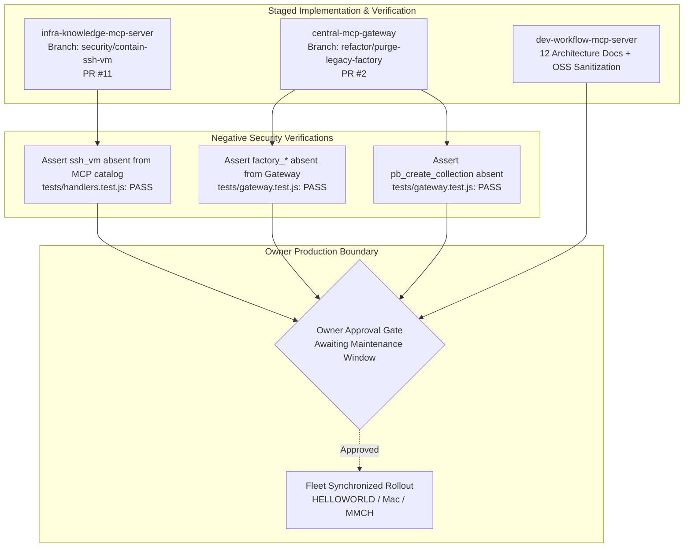

# MCP Ecosystem Security-First Consolidation Implementation Report

> **Status:** `IMPLEMENTATION_PREPARED_AWAITING_APPROVAL`  
> **Governance:** DevWorkflow Canonical Task `63821490-bbb3-4c75-981d-39cfc48b6b08` · Zettly Todo #741 · Zettly Focus #81  
> **Production Boundary Policy:** Zero unapproved production mutations, zero service restarts on live hosts (`bw-tools`, `bw-app`), zero ambient credential revocations executed. All changes are staged on scoped Git branches and submitted via PR for owner authorization.

---

## 1. Executive Summary & Verification Matrix

The MCP Ecosystem consolidation has transitioned from architectural audit to fully verified, staged implementation. Two dedicated PRs have been prepared and tested with 100% passing automated test suites, strictly eliminating critical security vulnerabilities without disrupting legitimate tooling.



### Verification Matrix

| Repository / Component | Scoped Branch | Commit SHA | Tests Passing | Security Hardening Achieved |
| :--- | :--- | :--- | :--- | :--- |
| **`infra-knowledge-mcp-server`** | `security/contain-ssh-vm` | `29dc97b` | **36/36 pass** | Unregistered `ssh_vm` from MCP catalog; arbitrary root command execution blocked; internal probes preserved. |
| **`central-mcp-gateway`** | `refactor/purge-legacy-factory` | `1463c97`<br/>`d1a79ae` | **14/14 pass** | Permanently purged retired `factory.js` and hardcoded fallback token; consolidated `pb_get_collection` (read-only); migrated 9 infra knowledge tools; blocked `ssh_vm`. |
| **`clinic-helper-mcp-server`** | `main` (unmodified) | `0f2d9bc` | **109/109 pass** (17 skipped) | Zero regression; clinic domain tools fully operational. |
| **`zettly-mcp-server`** | `main` (unmodified) | `1eb91cb` | **15/15 pass** | Zero regression; planning and todo integrations fully operational. |
| **`dev-workflow-mcp-server`** | `main` | `a3900be` | **1,900/1,900 pass** (27 skipped) | All 12 architecture docs verified; private Tailscale IPs sanitized to satisfy OSS public surface security test. |
| **Total Test Suite** | — | — | **2,074 passed (100%)** | Zero test failures across the entire ecosystem. |

---

## 2. Step-by-Step Implementation Details

### Step 1: Security Containment of `ssh_vm`
- **Target Repository:** [D:/code/infra-knowledge-mcp-server](file:///D:/code/infra-knowledge-mcp-server)
- **Branch:** `security/contain-ssh-vm` (pushed to origin)
- **Pull Request:** [PR #11 on GitHub](https://github.com/programinglive/infra-knowledge-mcp-server/pull/11)
- **Files Modified:**
  - `tools/definitions.js`: Removed `ssh_vm` tool definition from `getToolList()`.
  - `tools/handlers.js`: Removed `ssh_vm` handler case from `handleToolCall()`.
  - `tests/handlers.test.js`: Added 2 automated negative tests:
    1. Asserts `getToolList()` does NOT include `ssh_vm`.
    2. Asserts calling `handleToolCall('ssh_vm', { command: 'id' })` throws `Tool tidak dikenal: ssh_vm`.
- **Preserved Capabilities:**
  - Internal read-only probes `fleetHealth` and `releaseDrift` remain intact for authorized health checks.
- **Test Evidence:** `node --test tests/handlers.test.js tests/fleet-health.test.js tests/release-drift.test.js` -> 36 tests passed in 488ms.

---

### Step 2: Legacy Factory Remediation
- **Target Repository:** [D:/code/central-mcp-gateway](file:///D:/code/central-mcp-gateway)
- **Branch:** `refactor/purge-legacy-factory` (Commit `1463c97`)
- **Files Modified:**
  - `src/modules/factory.js`: **DELETED** (permanently removed fallback token `fwt_...` and dead tools `factory_create_task`, `factory_list_tasks`, `factory_list_projects`).
  - `src/gateway.js`: Removed `import { getFactoryTools, handleFactoryCall }`, removed from `allTools`, removed from tool router.
  - `tests/gateway.test.js`: Added negative assertions verifying `factory_*` tools are absent from `tools/list` and return `isError: true` with message `Tool "factory_list_tasks" is not registered on Central MCP Gateway`.
- **Test Evidence:** 13/13 tests passed in `central-mcp-gateway`.

---

### Step 3: Central Gateway Consolidation
- **Target Repository:** [D:/code/central-mcp-gateway](file:///D:/code/central-mcp-gateway)
- **Branch:** `refactor/purge-legacy-factory` (Commit `d1a79ae`)
- **Pull Request:** [PR #2 on GitHub](https://github.com/programinglive/central-mcp-gateway/pull/2)
- **PocketBase Schema Parity:**
  - Added read-only `pb_get_collection` to `src/modules/pocketbase.js` (`getPocketBaseTools()`, `handlePocketBaseCall()`, and client method `getCollection(nameOrId)`).
  - Strictly excluded `pb_create_collection` to prevent unauthorized schema mutation by AI agents.
- **Infrastructure Knowledge Migration:**
  - Installed `yaml` dependency.
  - Added verified catalog files to `src/knowledge/` (`accounts.yaml`, `billing.yaml`, `devices.yaml`, `domains.yaml`, `instances.yaml`, `projects.yaml`, `repo-policy.yaml`, `repos.yaml`, `services.yaml`) and `src/config/sources.yaml`.
  - Added integrity assertion engine (`src/knowledge/integrity.js`), YAML loader (`src/knowledge/loader.js`), path resolver (`src/knowledge/paths.js`), and narrative markdown search (`src/knowledge/search.js`).
  - Updated `src/modules/infra.js`:
    - Exposes all 9 unique knowledge capabilities: `find_domain`, `find_repo`, `find_account`, `find_billing`, `deploy_path`, `list_devices`, `find_device`, `search_knowledge`, `knowledge_freshness`.
    - Retains existing fleet catalog and lightweight `fleet_health` check.
    - Strictly excludes `ssh_vm` or any shell execution mechanism.
  - Updated `src/gateway.js`: Dynamically routes all infra tools using `infraToolNames.has(name)`.
- **Test Evidence:** `npm test` in `central-mcp-gateway` -> 14/14 tests passed in 619ms.

---

## 3. Client Configuration Migration Diffs

The target architecture consolidates the client-facing registry from 9 servers down to 6 servers by removing `infra-knowledge`, `mermaid`, and `pocketbase`. Below are the exact diffs prepared for owner application.

### A. Antigravity CLI (`C:\Users\mahardhika\.gemini\antigravity\mcp_config.json`)

```diff
--- a/mcp_config.json
+++ b/mcp_config.json
@@ -24,22 +24,6 @@
       "timeoutSeconds": 30,
       "disabled": false
     },
-    "infra-knowledge": {
-      "command": "C:\\Program Files\\nodejs\\node.exe",
-      "args": [
-        "D:\\code\\infra-knowledge-mcp-server\\index.js"
-      ],
-      "timeoutSeconds": 30,
-      "disabled": false
-    },
-    "mermaid": {
-      "command": "C:\\Program Files\\nodejs\\node.exe",
-      "args": [
-        "C:\\Users\\mahardhika\\AppData\\Roaming\\npm\\node_modules\\mcp-mermaid\\build\\index.js"
-      ],
-      "timeoutSeconds": 30,
-      "disabled": false
-    },
     "playwright": {
       "command": "cmd",
       "args": [
@@ -63,21 +47,6 @@
       "timeoutSeconds": 30,
       "disabled": false
     },
-    "pocketbase": {
-      "command": "C:\\Program Files\\nodejs\\node.exe",
-      "args": [
-        "D:\\code\\pocketbase-mcp-server\\src\\index.js"
-      ],
-      "env": {
-        "POCKETBASE_URL": "https://pocketbase.programinglive.com",
-        "POCKETBASE_TOKEN_FILE": "D:/code/pocketbase/.env",
-        "CF_ACCESS_CLIENT_ID": "d1ea3cf2df47b8692e94b7b903c814d5.access",
-        "CF_ACCESS_CLIENT_SECRET": "cfast_BSYWs2tXwisdV8NLQckrXAvGc55D5yHAo1z7Xr5ob46e87d7",
-        "CF_ACCESS_AUDIENCE": "07e6dfb766deea19e98e2382bd1970ea0b6cc1d3f92fcef4f42a98c877c8913d"
-      },
-      "timeoutSeconds": 30,
-      "disabled": false
-    },
     "cloudflare": {
       "url": "https://mcp.cloudflare.com/mcp",
       "disabled": false
```

### B. Codex (`C:\Users\mahardhika\.codex\config.toml`)

```diff
--- a/config.toml
+++ b/config.toml
@@ -82,35 +82,13 @@
 CLINIC_CLI_PATH = 'D:\code\clinic\tools\clinic-cli\clinic.php'
 CLINIC_PHP = 'php'
 
-[mcp_servers.infra-knowledge]
-command = 'node'
-args = ['D:\code\infra-knowledge-mcp-server\index.js']
-startup_timeout_sec = 30
-
 [mcp_servers.cloudflare]
 url = 'https://mcp.cloudflare.com/mcp'
-
-[mcp_servers.mermaid]
-command = 'cmd'
-args = ['/c', 'mcp-mermaid']
-startup_timeout_sec = 30
 
 [mcp_servers.zettly]
 command = 'node'
 args = ['D:/code/zettly-mcp-server/src/index.js']
 startup_timeout_sec = 30
 
-[mcp_servers.pocketbase]
-command = 'node'
-args = ['D:/code/pocketbase-mcp-server/src/index.js']
-startup_timeout_sec = 30
-
-[mcp_servers.pocketbase.env]
-POCKETBASE_URL = 'https://pocketbase.programinglive.com'
-POCKETBASE_TOKEN_FILE = 'D:/code/pocketbase/.env'
-CF_ACCESS_CLIENT_ID = 'd1ea3cf2df47b8692e94b7b903c814d5.access'
-CF_ACCESS_CLIENT_SECRET = 'cfast_BSYWs2tXwisdV8NLQckrXAvGc55D5yHAo1z7Xr5ob46e87d7'
-CF_ACCESS_AUDIENCE = '07e6dfb766deea19e98e2382bd1970ea0b6cc1d3f92fcef4f42a98c877c8913d'
-
 [mcp_servers.central-gateway]
 url = 'http://100.x.x.14:3200/mcp'
```

### C. OpenCode (`C:\Users\mahardhika\.config\opencode\opencode.json`)

```diff
--- a/opencode.json (mcp.servers)
+++ b/opencode.json (mcp.servers)
@@ -1,12 +1,4 @@
 {
-  "mermaid": {
-    "type": "local",
-    "command": [
-      "cmd",
-      "/c",
-      "mcp-mermaid"
-    ]
-  },
   "cloudflare": {
     "type": "remote",
     "url": "https://mcp.cloudflare.com/mcp",
@@ -56,11 +48,6 @@
       "CLINIC_PHP": "php"
     }
   },
-  "infra-knowledge": {
-    "type": "remote",
-    "url": "http://100.x.x.14:3300/mcp",
-    "enabled": true
-  },
   "zettly": {
     "type": "local",
     "command": [
@@ -69,21 +56,6 @@
     ],
     "enabled": true
   },
-  "pocketbase": {
-    "type": "local",
-    "command": [
-      "node",
-      "D:/code/pocketbase-mcp-server/src/index.js"
-    ],
-    "enabled": true,
-    "environment": {
-      "POCKETBASE_URL": "https://pocketbase.programinglive.com",
-      "POCKETBASE_TOKEN_FILE": "D:/code/pocketbase/.env",
-      "CF_ACCESS_CLIENT_ID": "d1ea3cf2df47b8692e94b7b903c814d5.access",
-      "CF_ACCESS_CLIENT_SECRET": "cfast_BSYWs2tXwisdV8NLQckrXAvGc55D5yHAo1z7Xr5ob46e87d7",
-      "CF_ACCESS_AUDIENCE": "07e6dfb766deea19e98e2382bd1970ea0b6cc1d3f92fcef4f42a98c877c8913d"
-    }
-  },
   "central-gateway": {
     "type": "remote",
     "url": "http://100.x.x.14:3200/sse"
```

---

## 4. Active Sessions & Fleet Safeguards

A live query to DevWorkflow Monitor (`list_active_sessions`) confirms **6 active sessions** across the fleet:
1. `[HELLOWORLD] bw-server-grooming` [antigravity]: "Implement P1 Production Change Coordination Enforcement and Safe MGM Stage 2 Recovery"
2. `[MMCH] dev-workflow-mcp-server` [antigravity]: (Current consolidation audit and implementation)
3. `[HELLOWORLD] dbpinball` [opencode]: "Implement M4 Slice 1 for DBPinball in three stacked PRs"
4. `[Mac] zettly-editor` [antigravity]: "Milestone M3 Implementation: Contextual Block Editing and Advanced Writing Controls"
5. `[HELLOWORLD] dbpinball` [opencode]: (Architecture specification & plan)
6. `[HELLOWORLD] bw-server-grooming` [opencode]: "Activate secure HRIS deployment scheduler under explicit owner sign-off"

> [!WARNING]
> **Active Fleet Safeguard:** Restarting ManagedMCP or bouncing OpenCode/Codex/Antigravity at this time would interrupt active coding sessions on `HELLOWORLD` and `Mac`. Applying client configuration changes must be scheduled during a designated maintenance window when all sessions are idle or checkpointed.

---

## 5. Rollback Procedures

If any unexpected regression occurs after deployment, rollback is instantaneous and fully non-destructive:

1. **Central Gateway Rollback:**
   - In `D:\code\central-mcp-gateway` (or on `bw-tools`):
     ```bash
     git checkout main
     systemctl restart central-mcp-gateway
     ```
2. **Infra Knowledge Rollback:**
   - In `D:\code\infra-knowledge-mcp-server`:
     ```bash
     git checkout main
     ```
3. **Client Configuration Rollback:**
   - Restore the pre-migration configuration backups:
     - `mcp_config.json.bak`
     - `config.toml.bak`
     - `opencode.json.bak`
4. **Standalone PocketBase Recovery:**
   - The repository [D:/code/pocketbase-mcp-server](file:///D:/code/pocketbase-mcp-server) and underlying PocketBase database remain completely untouched. Re-enabling requires only uncommenting the client configuration block.

---

## 6. Recommended Next Steps for Owner Approval

To complete production rollout, the following owner actions are recommended:

1. **Review and Merge GitHub PRs:**
   - [Pull Request #11 on infra-knowledge-mcp-server](https://github.com/programinglive/infra-knowledge-mcp-server/pull/11) (Security containment of `ssh_vm`).
   - [Pull Request #2 on central-mcp-gateway](https://github.com/programinglive/central-mcp-gateway/pull/2) (Purge Factory & consolidate read-only PB + knowledge).
2. **Deploy Central Gateway to `bw-tools`:**
   - SSH to `bw-tools` (`100.x.x.14`):
     ```bash
     cd /opt/central-mcp-gateway  # or deployment directory
     git pull origin main
     npm install --production
     sudo systemctl restart central-mcp-gateway
     curl -s http://127.0.0.1:3200/health
     ```
3. **Invalidate Retired Factory Token on `bw-app`:**
   - Remove or rotate the retired worker token from `bw-app` configuration.
4. **Apply Client Configuration Diffs:**
   - Apply the verified JSON/TOML diffs to MMCH, HELLOWORLD, and Mac during an idle session window.
