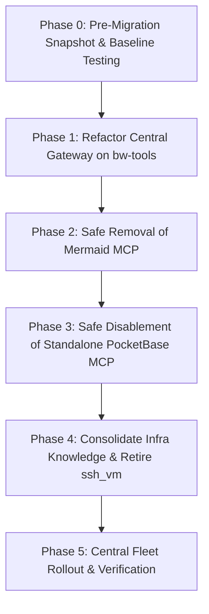

# MCP Ecosystem Consolidation & Safe Cleanup Plan

> **Scope:** Ordered, reversible, step-by-step implementation plan for migrating from 9 MCP servers to 6 servers.  
> **Governance:** Zero changes will be executed during this audit task. All steps require explicit owner approval prior to execution.

---

## 1. Migration Overview & Phasing

---

## 2. Phase-by-Phase Execution Plan

### Phase 0: Baseline Snapshot & Pre-Migration Verification
- **Goal:** Capture exact state of all configuration files and active tool connections before any modification.
- **Actions:**
  1. Create timestamped backups of client configuration files:
     - `C:\Users\mahardhika\.gemini\antigravity\mcp_config.json.bak-<timestamp>`
     - `C:\Users\mahardhika\.codex\config.toml.bak-<timestamp>`
     - `C:\Users\mahardhika\.config\opencode\opencode.json.bak-<timestamp>`
  2. Run `inspect-device-mcp.py` to record baseline MCP connection status.
  3. Verify baseline tool responsiveness on `central-gateway`, `dev-workflow`, `clinic-helper`, and `zettly`.
- **Exit Criteria:** Backups verified non-empty, baseline report recorded.

---

### Phase 1: Refactor Central Gateway (`central-gateway`)
- **Target Repository:** `D:\code\central-mcp-gateway` (Deployed on `bw-tools`)
- **Actions:**
  1. **Purge Factory Module:**
     - Delete `src/modules/factory.js`.
     - In `src/gateway.js`: Remove `import { getFactoryTools, handleFactoryCall }` and unregister from `allTools` and tool call router.
  2. **Add Missing Collection Schema Tools (if needed):**
     - Add `pb_get_collection` and `pb_create_collection` to `src/modules/pocketbase.js` so Central Gateway has full parity with standalone PocketBase.
  3. **Run Test Suite:**
     - Execute `npm test` in `D:\code\central-mcp-gateway`.
  4. **Deploy to `bw-tools`:**
     - Commit changes with message `refactor(gateway): purge retired factory module and expand pb schema tools`.
     - Deploy to `bw-tools` via git pull and reload systemd service.
- **Regression Test:**
  - Call `pb_health` and `pb_list_records` via Central Gateway. Confirm HTTP 200 responses.
  - Verify `factory_*` tools are no longer listed in `tools/list`.
- **Rollback:**
  - Git revert commit in `central-mcp-gateway`, redeploy to `bw-tools`.

---

### Phase 2: Safe Removal of Mermaid MCP (`mermaid`)
- **Target Server:** `mcp-mermaid` (Local stdio MCP)
- **Dependencies & Consumers:** None. AI agents generate raw Mermaid syntax in Markdown; viewers render client-side.
- **Actions:**
  1. Remove `mermaid` entry from:
     - `C:\Users\mahardhika\.gemini\antigravity\mcp_config.json`
     - `C:\Users\mahardhika\.codex\config.toml`
     - `C:\Users\mahardhika\.config\opencode\opencode.json`
  2. Restart AI client sessions.
- **Verification & Acceptance Test:**
  - Issue prompt asking for an architecture diagram. Confirm agent outputs valid Mermaid markdown code block.
  - Confirm markdown renders correctly in Antigravity chat UI and Zettly Draw Studio.
  - Verify background headless Chromium processes from `mermaid-isomorphic` are gone.
- **Rollback:**
  - Restore `mermaid` block from Phase 0 backup.

---

### Phase 3: Safe Disablement of Standalone PocketBase MCP (`pocketbase`)
- **Target Server:** `pocketbase-mcp-server` (Local stdio MCP)
- **Dependencies & Consumers:** Dev scripts or workflows querying PocketBase.
- **Replacement:** All queries route through `central-gateway` (`pb_health`, `pb_list_collections`, `pb_list_records`, `pb_get_record`, `pb_create_record`, `pb_update_record`, `pb_delete_record`).
- **Actions:**
  1. Comment out or remove `pocketbase` entry from `mcp_config.json`, `config.toml`, and `opencode.json`.
  2. Leave repository `D:\code\pocketbase-mcp-server` intact on disk (no deletion).
  3. Restart AI client sessions.
- **Verification & Acceptance Test:**
  - Call `call_mcp_tool` with `ServerName: "central-gateway"`, `ToolName: "pb_health"`. Verify status OK.
  - Call `pb_list_records` for a known collection. Verify records returned.
  - Confirm no duplicate `pb_*` tools exist in the agent's tool catalog.
- **Rollback:**
  - Restore `pocketbase` block in client config files.

---

### Phase 4: Consolidate Infra Knowledge (`infra-knowledge`) & Retire `ssh_vm`
- **Target Server:** `infra-knowledge-mcp-server`
- **Actions:**
  1. **Consolidate Knowledge Lookup:**
     - Copy YAML knowledge catalogs (`domains.yaml`, `billing.yaml`, `accounts.yaml`, `repos.yaml`) or link them into `central-mcp-gateway/src/modules/infra.js`.
     - Expose `find_domain`, `find_repo`, `find_billing`, `search_knowledge` via Central Gateway.
  2. **Decommission `ssh_vm`:**
     - Retire `tools/ssh_vm.js` from ambient AI MCP tools.
     - Provide an operator CLI script `scripts/ssh-node.sh` on `bw-tools` or local machine for explicit manual SSH access when needed by a human.
  3. **Disable `infra-knowledge` in client configs:**
     - Remove `infra-knowledge` from `mcp_config.json`, `config.toml`, and `opencode.json`.
- **Verification & Acceptance Test:**
  - Query infrastructure topology via `central-gateway` (`find_instance`, `infra_overview`, `find_domain`). Confirm accurate responses.
  - Verify `ssh_vm` is no longer reachable by AI agents.
- **Rollback:**
  - Re-enable `infra-knowledge` in client configs.

---

### Phase 5: Central Fleet Rollout & Verification
- **Target Devices:** `HELLOWORLD`, `Mac`, `MMCH`
- **Execution Script:** `node managed/rollout.cjs` and `node managed/fleet-status.cjs` (located in `dev-workflow-mcp-server/managed/`).
- **Actions:**
  1. Promote updated configuration via standard central release protocol on `bw-tools`.
  2. Run `node managed/restart-devices.cjs` to reload ManagedMCP processes across fleet.
  3. Run `node managed/fleet-status.cjs` to verify all three devices report green and synchronized on the new MCP topology.
- **Acceptance Criteria:**
  - All devices report 6 connected MCP servers.
  - Zero transport errors or failed servers.
  - All dev-workflow, clinic-helper, and zettly tasks proceed without interruption.

---

## 3. Owner Approval Gate

| Decision Item | Proposed Action | Requires Owner Approval? | Rationale |
|---|---|---|---|
| Purge Factory Module from Gateway | Delete `src/modules/factory.js` | **YES** | Code deletion in `central-mcp-gateway` repo. |
| Decommission `ssh_vm` | Remove `ssh_vm` tool | **YES** | Security hardening removing remote root command execution. |
| Remove Mermaid MCP | Remove `mcp-mermaid` from configs | **YES** | Config change eliminating redundant diagram rendering. |
| Disable Standalone PocketBase MCP | Remove `pocketbase` from configs | **YES** | Config change standardizing DB access via Central Gateway. |
| Fleet Rollout across Devices | Run `managed/rollout.cjs` | **YES** | Propagates changes to HELLOWORLD, Mac, and MMCH. |
