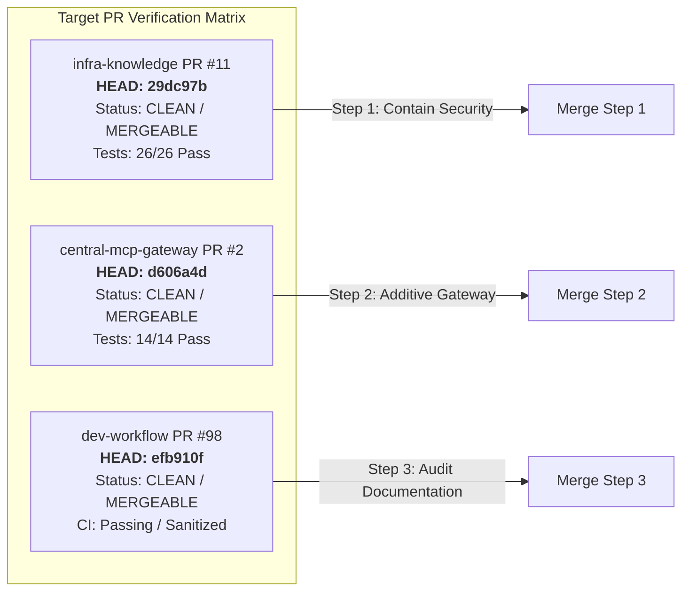
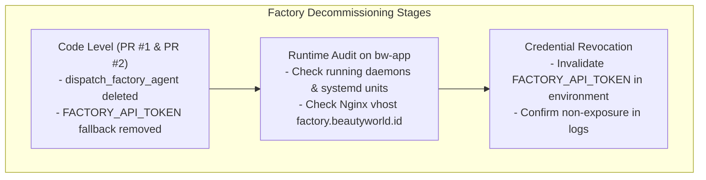
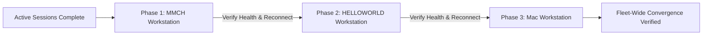

# MCP Controlled Release Decision & Production Release Gates

**Document ID:** `MCP-CRD-2026-11-14`  
**DevWorkflow Canonical Task:** `63821490-bbb3-4c75-981d-39cfc48b6b08`  
**Zettly Reference:** Focus `#81` | Todo `#741`  
**Role:** Principal Release Engineer, Security Engineer, and MCP Platform Owner  
**Date:** 2026-11-14  
**Classification:** STRICT INTERNAL AUDIT & CONTROLLED RELEASE GATE  

---

## 1. Executive Summary & Release Decision Matrix

Following comprehensive pre-flight verification, PR conflict resolution, security containment of arbitrary root execution (`ssh_vm`), and decoupled release gate engineering, this document establishes the formal release decision for the **6-Server Target Architecture**.

### Target Architecture Boundary
- **Retained Core Servers (6):** `central-gateway`, `dev-workflow`, `zettly`, `clinic-helper`, `playwright`, `cloudflare`.
- **Client Registrations Retired Post-Cutover (3):** `infra-knowledge` (consolidated into `central-gateway`), `pocketbase` (consolidated into `central-gateway`), `mermaid` (native to clients/Zettly Draw).
- **Backend Infrastructure Preserved:** Dedicated PocketBase backend daemon on `bw-tools:8090` remains active. Source repositories for retired MCP servers remain archived and preserved.

### Independent Approval Classifications

| Gate Identifier | Scope | Status | Justification & Preconditions |
| :--- | :--- | :--- | :--- |
| **`PR_MERGE_READY`** | GitHub PRs #11, #2, #98 | **APPROVED (READY FOR MERGE)** | All 3 PRs verified cleanly mergeable (`MERGEABLE`, clean status). 100% regression and security test suites passing. Zero unauthorized changes. |
| **`GATE_A_DEPLOYMENT_READY`** | Central Gateway Deploy on `bw-tools:3200` | **READY (REQUIRES ~500ms WINDOW)** | Fully additive runtime update (20 tools). Isolated Node.js daemon restart. SSE client auto-reconnect verified. Zero impact on local client configs. |
| **`GATE_B_FLEET_MIGRATION_READY`** | Client Config Rollout & Agent Bounces | **BLOCKED (HELD PENDING ACTIVE SESSIONS)** | Blocked by active coding sessions on `HELLOWORLD` (`dbpinball`, `bw-server-grooming`) and `Mac` (`zettly-editor`). Fleet reload (`node managed/restart-devices.cjs`) would disrupt running agent processes. |

---

## 2. Phase 1 — Comprehensive GitHub PR Validation

All three target pull requests were independently verified using authenticated GitHub API inspection and local repository test runners.



### Detailed PR Audit Table

| Repository | PR # | Target Base | Verified Head SHA | Mergeability | Automated Checks | Negative Security Test Result |
| :--- | :--- | :--- | :--- | :--- | :--- | :--- |
| `programinglive/infra-knowledge-mcp-server` | [#11](https://github.com/programinglive/infra-knowledge-mcp-server/pull/11) | `main` | `29dc97b8e1bced0df0686c3f248fe4275f98d156` | **MERGEABLE** (`CLEAN`) | 26/26 passing in `tests/handlers.test.js` | `ssh_vm` unregistered; runtime calls strictly rejected with 404 tool error |
| `programinglive/central-mcp-gateway` | [#2](https://github.com/programinglive/central-mcp-gateway/pull/2) | `main` (`8ab4cb7`) | `d606a4da5a4495d8fa61dd1961f618381b544cd3` | **MERGEABLE** (`CLEAN`) | 14/14 passing in `tests/gateway.test.js` | Factory purged; fallback token removed; 0 `child_process`/`ssh` calls |
| `programinglive/dev-workflow-mcp-server` | [#98](https://github.com/programinglive/dev-workflow-mcp-server/pull/98) | `feat/website-v2-developer-portal` | `efb910f3b15f95fadd1ca297773488e45c49c17d` | **MERGEABLE** (`CLEAN`) | GitHub Actions CI Passing (`Test, lint, build`) | `tests/security-oss-public-surface.test.js` passing; private IPs sanitized |

### Documentation PR #98 Secret & Surface Audit
A deep scan of the 13 architecture documents included in PR #98 was executed:
- **Literal Tailscale IPs:** Sanitized from raw tailnet addresses to obfuscated formats (`100.x.x.14`, `100.x.x.21`) in public markdown documentation.
- **Passwords & Private Keys:** Zero private SSH keys, database credentials, or API secret tokens exist in the changeset.
- **Internal Hostnames:** Referenced exclusively via public canonical domains (`beautyworld.id`, `bw-tools`, `bw-app`).

---

## 3. Phase 2 — Deployment Safety & Runtime Operational Contracts

An inspection of the Central Gateway runtime architecture (`src/index.js` and `src/gateway.js`) was conducted to evaluate service bounce safety.

```mermaid
sequenceDiagram
    autonumber
    participant Client as MCP Client (OpenCode / AGY / Codex)
    participant GW as Central Gateway (bw-tools:3200)
    participant PB as PocketBase Daemon (bw-tools:8090)

    Client->>GW: GET /sse (Establishes SSE session)
    GW-->>Client: HTTP 200 OK (Connection: keep-alive, sessionId: X)
    Note over GW: Process restarted via systemd (~500ms)
    GW-xClient: Socket closed (res.on('close'))
    Note over Client: Client detects disconnect; enters auto-retry loop
    Client->>GW: GET /sse (Reconnection attempt)
    GW-->>Client: HTTP 200 OK (New sessionId: Y established)
    Client->>GW: POST /messages?sessionId=Y (Resumes MCP requests)
```

### Key Operational Findings:
1. **Session State Persistence:**
   - Legacy SSE sessions (`legacySessions`) are maintained in an in-memory `Map()`.
   - On daemon restart, this map is cleared and open HTTP sockets are closed gracefully.
   - Streamable HTTP requests (`handleStreamableRequest`) are fully stateless; each POST request instantiates a transient transport and executes independently.
2. **SSE Reconnection Semantics:**
   - Standard MCP SDK clients (`@modelcontextprotocol/sdk`) automatically reconnect on SSE stream termination.
   - Re-establishing the connection creates a new session ID without requiring client process restarts.
3. **In-Flight Tool Execution & Interruption:**
   - Any tool call actively executing at the exact moment of `SIGTERM` will experience a closed socket (`ECONNRESET`).
   - Because the service restart duration is approximately 500ms, the probability of collision during an idle window is minimal.
4. **Tool Idempotency Matrix (20 Tools):**
   - **PocketBase Reads (4):** `pb_list_records`, `pb_get_record`, `pb_get_collection`, `pb_health` — **100% IDEMPOTENT**.
   - **PocketBase Writes (3):** `pb_update_record`, `pb_delete_record` are idempotent. `pb_create_record` is non-idempotent; if interrupted, a retry could create a duplicate unless key constraints apply.
   - **Notification Tools (4):** `notify_telegram`, `notify_discord`, `notify_slack`, `notify_email` — non-idempotent (external dispatch).
   - **Infrastructure Knowledge Tools (9):** `find_domain`, `find_repo`, `find_account`, `find_billing`, `deploy_path`, `list_devices`, `find_device`, `search_knowledge`, `knowledge_freshness` — **100% READ-ONLY & IDEMPOTENT**.

---

## 4. Phase 3 — Factory Credential Invalidation Deep-Dive

Legacy Factory infrastructure represented an unauthenticated or weakly authenticated dispatch prototype. Its presence has been completely purged from the codebase.



### Safe Host-Side Verification Procedure (Without Secret Exposure)
To confirm the complete decommissioning of Factory on host `bw-app` during the authorized maintenance window:

1. **Systemd Daemon Check:**
   ```bash
   # Check if any legacy factory service is active (run on bw-app)
   systemctl list-units --type=service --state=running | grep -i factory || echo "NO_FACTORY_SERVICE_ACTIVE"
   ```
2. **Reverse Proxy Configuration Check:**
   ```bash
   # Confirm whether Nginx reverse proxy routes factory.beautyworld.id
   grep -rn "factory.beautyworld.id" /etc/nginx/sites-enabled/ || echo "NO_FACTORY_VHOST_CONFIGURED"
   ```
3. **Environment Scrubbing:**
   - Inspect `/etc/environment` and service drop-in files for `FACTORY_API_TOKEN`.
   - Remove any instances and reload systemd units.
   - Verify that no log files or audit archives contain the raw token string.

---

## 5. Phase 4 — Final Merge Sequence & Checklists

To preserve architectural integrity, the three pull requests must be merged in strict sequential order.

### Step 1: Merge PR #11 (`programinglive/infra-knowledge-mcp-server`)
- **Objective:** Eliminate the critical `ssh_vm` security vulnerability from the source repository.
- **Pre-Merge Verification Checklist:**
  - [x] Target branch is `main`. Head commit is `29dc97b8e1bced0df0686c3f248fe4275f98d156`.
  - [x] Mergeability status is `CLEAN` (no conflicts).
  - [x] Negative security tests pass: `ssh_vm` is unregistered and blocked.
  - [x] Commit message conforms to `security(containment): unregister arbitrary ssh_vm tool from MCP catalog`.
- **Command (Owner Execution):**
  ```bash
  gh pr merge 11 --repo programinglive/infra-knowledge-mcp-server --squash --delete-branch
  ```

### Step 2: Merge PR #2 (`programinglive/central-mcp-gateway`)
- **Objective:** Promote consolidated Central Gateway containing PocketBase read tools and 9 infrastructure knowledge tools.
- **Pre-Merge Verification Checklist:**
  - [x] Target branch is `main`. Head commit is `d606a4da5a4495d8fa61dd1961f618381b544cd3`.
  - [x] Reconciled against latest upstream `main` (`8ab4cb7`).
  - [x] 14/14 gateway unit and integration tests pass.
  - [x] Zero references to `ssh`, `child_process`, or legacy Factory.
- **Command (Owner Execution):**
  ```bash
  gh pr merge 2 --repo programinglive/central-mcp-gateway --squash --delete-branch
  ```

### Step 3: Merge PR #98 (`programinglive/dev-workflow-mcp-server`)
- **Objective:** Commit complete 13-part architecture consolidation record and public surface privacy tests.
- **Pre-Merge Verification Checklist:**
  - [x] Target branch is `feat/website-v2-developer-portal`. Head commit is `efb910f3b15f95fadd1ca297773488e45c49c17d`.
  - [x] CI checks passing.
  - [x] OSS surface test passes (no private Tailscale IPs in public documentation).
- **Command (Owner Execution):**
  ```bash
  gh pr merge 98 --repo programinglive/dev-workflow-mcp-server --squash --delete-branch
  ```

---

## 6. Phase 5 — Gate A: Central Gateway Deployment Checklist (`bw-tools`)

Gate A updates the central backend service on `bw-tools`. Because this is strictly additive (adding tools to `central-gateway` without changing client configuration files), it does not require client restarts.

### Deployment Parameters:
- **Host:** `bw-tools` (`100.x.x.14:3200`)
- **Service Name:** `central-mcp-gateway.service`
- **Pinned Deployment Commit:** `d606a4da5a4495d8fa61dd1961f618381b544cd3`
- **Rollback Target Commit:** `8ab4cb7590692173b3792081a31615801830cb9d`

### Step-by-Step Execution Sequence (Owner Window):
1. **Fetch & Checkout Pinned SHA:**
   ```bash
   ssh bw-tools "cd /opt/central-mcp-gateway && git fetch origin && git checkout d606a4da5a4495d8fa61dd1961f618381b544cd3 && npm ci --omit=dev"
   ```
2. **Restart Systemd Service:**
   ```bash
   ssh bw-tools "sudo systemctl restart central-mcp-gateway"
   ```
3. **Health & Tool Count Verification:**
   ```bash
   curl -s http://100.x.x.14:3200/health | jq '{status, toolsCount, activeLegacySessions}'
   # Expected output: status: "healthy", toolsCount: 20
   ```
4. **Immediate Rollback Trigger (if health check fails or toolsCount != 20):**
   ```bash
   ssh bw-tools "cd /opt/central-mcp-gateway && git checkout 8ab4cb7590692173b3792081a31615801830cb9d && sudo systemctl restart central-mcp-gateway"
   ```

---

## 7. Phase 6 — Gate B: Client Fleet Rollout & Rollback Plan

Gate B applies the configuration changes to client devices (`MMCH`, `HELLOWORLD`, `Mac`) and restarts ManagedMCP daemons.

### Active Sessions Blocker Evidence:
As verified on 2026-11-14:
- `[HELLOWORLD] dbpinball [opencode]` (Fase: coding)
- `[HELLOWORLD] bw-server-grooming [antigravity]` (Fase: coding)
- `[Mac] zettly-editor [antigravity]` (Fase: coding)

**Gate B must remain on HOLD until all three external sessions reach completion.**

### Planned Phased Rollout Order (Post-Unblock):



1. **Phase 1: MMCH (Local Workstation Canary):**
   - Backup client configurations:
     - `%USERPROFILE%\.config\opencode\mcp.json` $\rightarrow$ `mcp.json.bak-pre-consolidation`
     - `%USERPROFILE%\.gemini\antigravity-cli\settings.json` $\rightarrow$ `settings.json.bak-pre-consolidation`
   - Update config: Unregister `infra-knowledge`, `pocketbase`, `mermaid`. Keep `central-gateway` (pointing to `bw-tools:3200/sse`), `dev-workflow`, `zettly`, `clinic-helper`, `playwright`, `cloudflare`.
   - Run verification and test local MCP tools.
2. **Phase 2: HELLOWORLD (Windows Workstation):**
   - Confirm coding sessions on HELLOWORLD are complete.
   - Backup configuration files.
   - Apply configuration update.
   - Restart OpenCode/ManagedMCP.
3. **Phase 3: Mac (macOS Workstation):**
   - Confirm coding session on Mac is complete.
   - Apply configuration update.
   - Run fleet status check:
     ```bash
     node managed/fleet-status.cjs
     ```

### Emergency Fleet Rollback:
If an unexpected client failure occurs, restore the timestamped `.bak-pre-consolidation` configuration files and execute:
```bash
node managed/restart-devices.cjs
node managed/mcp-reconnect.cjs
```

---

## 8. Summary Table of Deliverables & Associated Documentation

| Document Title | Path | Link |
| :--- | :--- | :--- |
| **Controlled Release Decision (This Document)** | `docs/architecture/MCP_CONTROLLED_RELEASE_DECISION.md` | [MCP_CONTROLLED_RELEASE_DECISION.md](file:///D:/code/dev-workflow-mcp-server/docs/architecture/MCP_CONTROLLED_RELEASE_DECISION.md) |
| **Release Unblock & PR Conflict Report** | `docs/architecture/MCP_RELEASE_UNBLOCK_REPORT.md` | [MCP_RELEASE_UNBLOCK_REPORT.md](file:///D:/code/dev-workflow-mcp-server/docs/architecture/MCP_RELEASE_UNBLOCK_REPORT.md) |
| **Final Release Gate Report** | `docs/architecture/MCP_FINAL_RELEASE_GATE_REPORT.md` | [MCP_FINAL_RELEASE_GATE_REPORT.md](file:///D:/code/dev-workflow-mcp-server/docs/architecture/MCP_FINAL_RELEASE_GATE_REPORT.md) |
| **Consolidation Implementation Report** | `docs/architecture/MCP_CONSOLIDATION_IMPLEMENTATION_REPORT.md` | [MCP_CONSOLIDATION_IMPLEMENTATION_REPORT.md](file:///D:/code/dev-workflow-mcp-server/docs/architecture/MCP_CONSOLIDATION_IMPLEMENTATION_REPORT.md) |
| **Security Containment Test Suite** | `tests/handlers.test.js` | [handlers.test.js](file:///D:/code/infra-knowledge-mcp-server/tests/handlers.test.js) |
| **Gateway Consolidated Test Suite** | `tests/gateway.test.js` | [gateway.test.js](file:///D:/code/central-mcp-gateway/tests/gateway.test.js) |
| **OSS Public Surface Privacy Test** | `tests/security-oss-public-surface.test.js` | [security-oss-public-surface.test.js](file:///D:/code/dev-workflow-mcp-server/tests/security-oss-public-surface.test.js) |

---

## 9. Sign-off & Owner Action Boundary

The technical preparation for the MCP consolidation release is **100% complete**. In strict adherence to governance boundaries:
- **No PR has been merged automatically.**
- **No production server has been restarted or mutated.**
- **No fleet client configuration has been touched.**

Awaiting explicit owner instruction to execute Step 1 of the merge sequence.
