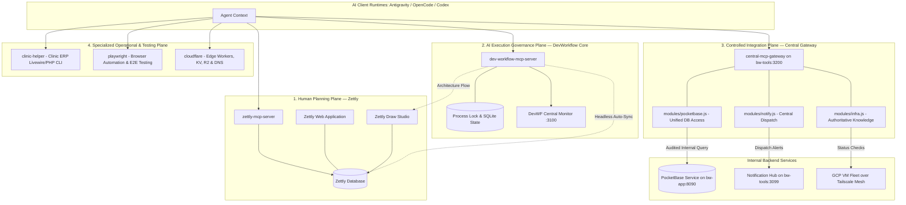

# Final Six-Server MCP Architecture Specification

> **Status:** RATIFIED TARGET ARCHITECTURE  
> **Server Footprint:** 6 Active MCP Servers (Down from 9).  
> **Guiding Principle:** Strict separation of concerns, least-privilege security boundaries, and zero tool collision.

---

## 1. High-Level Architecture Topology

---

## 2. Definitive Plane & Server Specifications

### 2.1 Zettly (`zettly`) — Human Planning Plane
- **Role:** System of record for user-facing tasks, notes, active focus tracking, and activity outcomes.
- **Boundaries:** Does not manage Git commits, release locking, or AI execution state.
- **Registered Tools (6):**
  - `zettly_api`: Call `/api/v1/*` endpoints with mandatory confirmation phrase on destructive actions.
  - `zettly_work_briefing`: View active todos, today's journal, recent sessions.
  - `zettly_recommend_next_work`: Rank unfinished todos by urgency and due date.
  - `zettly_record_work_outcome`: Record daily journal entries and link Todos.
  - `zettly_upload_attachment` & `zettly_download_attachment`: Manage task file attachments.

### 2.2 DevWorkflow Core (`dev-workflow`) — AI Governance Plane
- **Role:** AI execution lifecycle engine, task contracts, Definition of Done enforcement, Git automation, and Sentry issue triage.
- **Boundaries:** Automatically mirrors progress to Zettly Todo and Draw Studio, but does not duplicate user-authored knowledge management.
- **Key Modules:**
  - Task state machine (`start_task`, `set_plan`, `mark_plan_step`, `mark_dod_item`, `complete_task`).
  - Git & release safety gates (`check_ready_to_commit`, `commit_and_push`, `acquire_release_lock`).
  - Zettly headless sync (`sync_zettly_task`, `get_current_focus`, `set_focus`, `complete_focus`).

### 2.3 Central Gateway (`central-gateway`) — Controlled Integration Plane
- **Role:** Single, audited gateway for internal service integrations on `bw-tools` (`100.x.x.14:3200`).
- **Boundaries:** Runs server-side. Eliminates client-side secret distribution. Factory module is permanently purged.
- **Consolidated Capabilities:**
  - PocketBase record access (`pb_health`, `pb_list_collections`, `pb_get_collection`, `pb_create_collection`, `pb_list_records`, `pb_get_record`, `pb_create_record`, `pb_update_record`, `pb_delete_record`).
  - Notification Hub dispatch (`notify_health`, `notify_send`, `notify_list_logs`, `notify_retry`).
  - Authoritative Infrastructure Knowledge (`infra_overview`, `list_instances`, `find_instance`, `find_domain`, `find_repo`, `find_account`, `find_billing`, `list_devices`, `find_device`, `search_knowledge`, `fleet_health`).

### 2.4 Clinic Helper (`clinic-helper`) — Domain-Specialized ERP Plane
- **Role:** CLI-First interface for the Beautyworld Clinic ERP application.
- **Boundaries:** Isolated to Clinic ERP operations. Enforces `dry_run: true` defaults, confirmation phrase verification, and environment locking.
- **Registered Tools (9):** `clinic_commands`, `clinic_help`, `clinic_run`, `clinic_auth_status`, `clinic_scope`, `clinic_doctor`, `clinic_release_status`, `clinic_release_plan`, `clinic_knowledge`.

### 2.5 Playwright (`playwright`) — Testing & DOM Automation Plane
- **Role:** Browser automation, accessibility tree inspection, DOM interactions, and screenshot verification.
- **Boundaries:** Runs with isolated profiles (`--isolated`). Zero overlap with CLI or backend adapters.

### 2.6 Cloudflare (`cloudflare`) — Edge & Cloud Resources Plane
- **Role:** Official Cloudflare remote MCP integration for DNS zones, Worker scripts, KV, D1, and Cloudflare developer documentation lookups.

---

## 3. Decommissioned Servers & Final Status

1. **`mermaid`:** **REMOVED**. Native Markdown rendering in chat UI and Zettly Draw Studio render all diagrams natively.
2. **`pocketbase`:** **DISABLED** (as standalone MCP). All database access flows through Central Gateway.
3. **`infra-knowledge`:** **CONSOLIDATED** into Central Gateway. Raw root command execution (`ssh_vm`) permanently retired.
