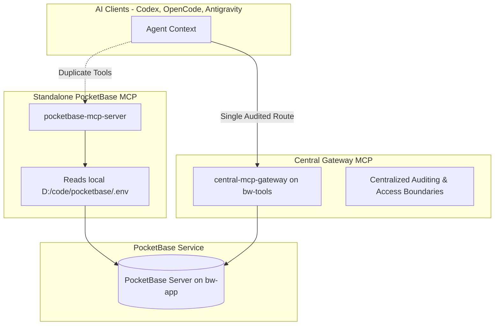

# MCP Functional Overlap Matrix

> **Scope:** Tool-level and boundary comparison across all paired MCP servers.  
> **Classification Standard:**
> - `EXACT_DUPLICATE`: Same functionality, same schemas, redundant tool registration.
> - `PARTIAL_OVERLAP`: Substantial commonality with differences in transport, auth, or auxiliary tools.
> - `SHARED_BACKEND_DIFFERENT_PURPOSE`: Interacts with the same backend but solves distinct architectural needs.
> - `INTENTIONAL_ISOLATION`: Separate by design to preserve security, tenant safety, or protocol boundaries.
> - `UNIQUE_CAPABILITY`: Exists solely on one server with no counterpart.

---

## 1. Functional Comparison Matrix

| Evaluation Pair | Classification | Key Overlap Area | Divergence / Distinction | Recommendation |
|---|---|---|---|---|
| **central-gateway vs pocketbase** | `PARTIAL_OVERLAP` / `EXACT_DUPLICATE` (CRUD) | 7 exact duplicate tools (`pb_health`, `pb_list_collections`, `pb_list_records`, `pb_get_record`, `pb_create_record`, `pb_update_record`, `pb_delete_record`) | Standalone has schema mutation tools (`pb_get_collection`, `pb_create_collection`) and local CF Access token reading; Gateway runs remotely on `bw-tools` | **Disable Standalone PocketBase MCP**. Add schema tools to Central Gateway if needed. Centralize credentials. |
| **central-gateway vs infra-knowledge** | `PARTIAL_OVERLAP` / `EXACT_DUPLICATE` (Fleet) | 4 exact duplicate tools (`infra_overview`, `list_instances`, `find_instance`, `fleet_health`) | `infra-knowledge` loads structured YAML files (`domains`, `billing`, `repos`) and has dangerous `ssh_vm`; `central-gateway` had hardcoded JS array | **Consolidate infra knowledge into Central Gateway**. Decommission `ssh_vm` from AI tool context; replace with operator CLI. |
| **zettly vs dev-workflow** | `INTENTIONAL_ISOLATION` | Both interface with Zettly Todos and Foci | `dev-workflow` is an AI execution engine (state machine, DoD proofs, git gates); `zettly` is the Human Planning system of record (briefing, daily journal, user notes) | **Keep Both Separated**. Preserves AI governance vs Human planning boundaries. |
| **clinic-helper vs other MCPs** | `UNIQUE_CAPABILITY` | None | Domain-specific Laravel CLI wrapper for Beautyworld Clinic ERP with dry-run and confirmation guards | **Keep Isolated**. Adheres strictly to the CLI-first architectural rule. |
| **mermaid vs existing tooling** | `EXACT_DUPLICATE` (Replaceable) | Diagram generation | `mcp-mermaid` renders base64 PNG via headless Chromium; UI viewers and Zettly Draw Studio render native markdown diagrams without server overhead | **Remove Mermaid MCP**. Zero impact on workflows; saves memory and process clutter. |
| **playwright vs clinic-helper** | `INTENTIONAL_ISOLATION` | None | `playwright` is browser DOM automation; `clinic-helper` is headless backend PHP CLI execution | **Keep Both Isolated**. Distinct testing vs application operational layers. |
| **cloudflare vs infra tools** | `INTENTIONAL_ISOLATION` | Infrastructure operations | `cloudflare` manages Cloudflare edge workers, KV, and DNS; infra tools manage internal private GCP VMs via Tailscale | **Keep Both Isolated**. Distinct public edge vs private backend infrastructure. |

---

## 2. Deep Dive Analysis by Pair

### 2.1 Central Gateway vs Standalone PocketBase

- **Tool Overlap Breakdown:**
  - `pb_health`: Exact duplicate.
  - `pb_list_collections`: Exact duplicate.
  - `pb_list_records`: Exact duplicate.
  - `pb_get_record`: Exact duplicate.
  - `pb_create_record`: Exact duplicate.
  - `pb_update_record`: Exact duplicate.
  - `pb_delete_record`: Exact duplicate.
  - `pb_get_collection`: Standalone only.
  - `pb_create_collection`: Standalone only.
- **Architectural Analysis:**
  Exposing both servers creates tool collision in AI context (duplicate names or shadowing). Running standalone PocketBase distributes superuser admin credentials across client machines.
- **Verdict:** `DISABLE` standalone `pocketbase-mcp-server`. Standardize on `central-mcp-gateway` for all PocketBase database access.

---

### 2.2 Central Gateway vs Infra Knowledge

- **Tool Overlap Breakdown:**
  - `infra_overview`, `list_instances`, `find_instance`, `fleet_health`: Exact duplicate tool names and purpose.
  - `find_domain`, `find_repo`, `find_account`, `find_billing`, `deploy_path`, `list_devices`, `find_device`, `search_knowledge`: Knowledge retrieval tools present only in `infra-knowledge`.
  - `ssh_vm`: Command execution tool present only in `infra-knowledge`.
- **Architectural Analysis:**
  - Maintaining two separate servers that both claim to report fleet status caused past drifts (e.g., stale VM references).
  - The static YAML files in `infra-knowledge/knowledge` represent authoritative architecture documentation. Moving their read handlers into Central Gateway unifies infrastructure knowledge under one roof.
  - `ssh_vm` is a major security hazard: an ambient AI tool that can execute arbitrary bash as root on production servers must be eliminated.
- **Verdict:** `CONSOLIDATE` knowledge retrieval into Central Gateway. Strip out `ssh_vm` from MCP toolsets.

---

### 2.3 Zettly vs DevWorkflow

- **Tool Overlap Breakdown:** Zero shared tool names.
- **Architectural Boundaries:**
  - `zettly-mcp-server`: Exposes the human planning plane (`zettly_work_briefing`, `zettly_recommend_next_work`, `zettly_record_work_outcome`, attachments).
  - `dev-workflow-mcp-server`: Exposes the AI execution governance plane (`start_task`, `set_plan`, `mark_plan_step`, `mark_dod_item`, `commit_and_push`).
- **Interaction Model:**
  - DevWorkflow acts as an internal client of Zettly's API to link active focuses and tasks automatically without human intervention.
  - Zettly MCP allows human-agent collaboration on daily journaling and task selection.
- **Verdict:** `INTENTIONAL_ISOLATION`. Maintain strict separation of concerns.

---

### 2.4 Mermaid MCP vs Native Tooling

- **Tool Overlap Breakdown:**
  - `generate_mermaid_diagram`: Takes mermaid text -> returns base64 PNG.
- **Existing Alternatives:**
  - Antigravity IDE and CLI: Native Markdown Mermaid renderer.
  - OpenCode and Codex: Native Markdown Mermaid renderer.
  - Zettly Draw Studio: DevWorkflow automatically creates linked interactive drawings (`https://zettly.programinglive.com/draw/<id>`).
  - Offline export: Standard CLI `npx @mermaid-js/mermaid-cli -i input.mmd -o output.png`.
- **Verdict:** `EXACT_DUPLICATE (REPLACEABLE)`. Safe to remove completely.
