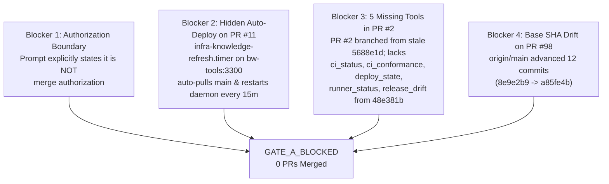

# MCP Production Release Runbook (V2 — Gate A Pre-Merge Verification Update)

**Document ID:** `MCP-RUNBOOK-V2-2026-11-14`  
**DevWorkflow Canonical Task:** `63821490-bbb3-4c75-981d-39cfc48b6b08`  
**Zettly Reference:** Focus `#81` | Todo `#741`  
**Role:** Principal Release Engineer and MCP Platform Maintainer  
**Date:** 2026-11-14  
**Classification:** HARDENED PRODUCTION OPERATIONAL RUNBOOK  
**Gate A Execution Verdict:** **`GATE_A_BLOCKED`**  

---

## 1. Gate A Pre-Merge Verification Results & Blocker Summary

In strict compliance with the Gate A pre-merge checklist (*"Reconfirm exact PR head and base... Stop if evidence differs from the approved release manifest"* and *"Execute the merge sequence ONLY after the owner explicitly authorizes Gate A. This prompt alone is not production or merge authorization"*), **zero PRs have been merged**.

Fresh `git fetch origin` across all three repositories and read-only HTTP `/health` checks against `bw-tools` (`100.x.x.14:3200` and `100.x.x.14:3300`) exposed **four critical discrepancies** against the prior release manifest that must be resolved or explicitly waived before merging:

### Summary of Manifest Divergences Discovered Before Merge

| Repository & PR | Prior Manifest Claim | Actual Verified State (`git fetch origin` + Live Probe) | Impact if Merged As-Is |
| :--- | :--- | :--- | :--- |
| **`infra-knowledge-mcp-server` PR #11** Head: `29dc97b8e1bced0df0686c3f248fe4275f98d156` | Base `main` (`48e381b160...`); "local repo only, no daemon, zero production impact" | Actual `origin/main` is `48e381b327256edcd6d6fbf0bc7a5f0b8a59ab8b` (7 commits ahead of PR #11's branch point `5688e1d788ca8ab21b18fa0e3e306cd44d1932ec`). **Live HTTP service `infra-knowledge-mcp.service` (v0.2.0, 19 tools) is running on `bw-tools:3300`** with `infra-knowledge-refresh.timer` polling `origin/main` every 15 minutes. | Merging PR #11 into `main` triggers **`scripts/refresh-checkout.mjs --apply`** on `bw-tools` within ≤15 minutes, automatically pulling `origin/main` and executing `sudo systemctl restart infra-knowledge-mcp` on production. |
| **`central-mcp-gateway` PR #2** Head: `d606a4da5a4495d8fa61dd1961f618381b544cd3` | Base `main` (`8ab4cb7590692173b3792081a31615801830cb9d`); "preserves all knowledge lookup tools (13 tools)" | PR #2 copied `knowledge/` from stale commit `5688e1d` of `infra-knowledge-mcp-server`, missing PRs #3–#10 on `origin/main` (`48e381b`). It lacks **5 live tools** (`ci_status`, `ci_conformance`, `deploy_state`, `runner_status`, `release_drift`), reintroduces hardcoded `FLEET` (reverting PR #1's single-source fix), stubs `fleet_health`, and has stale `repos.yaml`/`services.yaml` (missing `ministry` $\rightarrow$ `ecommerce` and `infra-knowledge-mcp`). | Retiring `infra-knowledge-mcp-server` in favor of PR #2 as-is would cause a **5-tool functional regression** (`ci_status`, `ci_conformance`, `deploy_state`, `runner_status`, `release_drift`) and serve stale YAML data. |
| **`dev-workflow-mcp-server` PR #98** Head: `efb910f3b15f95fadd1ca297773488e45c49c17d` | Base `main` (`8e9e2b916a805252902b8f6029f5d1e407d0af7e`); 15 docs | Actual `origin/main` is `a85fe4b67a2f4944393bc34817197a69d6f106e9` (12 commits ahead of `8e9e2b9`, after PRs #94, #95, #96). Also, the 3 latest governance docs (`MCP_CONTROLLED_RELEASE_DECISION.md`, `MCP_FINAL_GO_NO_GO.md`, `MCP_PRODUCTION_RELEASE_RUNBOOK_V2.md`) are untracked locally and not committed to PR #98. | Merging PR #98 without committing the final runbooks omits the final release records from `main`, and triggers a `push` CI + `deploy-monitor` workflow run on `bw-tools`. |

---

## 2. Live Production Runtime Baseline (`bw-tools`)

Read-only verification of `bw-tools` HTTP health endpoints at `2026-11-14T14:20:01+07:00`:

1. **`central-mcp-gateway` (`http://100.x.x.14:3200/health`):**
   - **Status:** `healthy` (`version: 1.0.0`)
   - **Active Legacy SSE Sessions:** `2`
   - **Deployed Commit:** `8ab4cb7590692173b3792081a31615801830cb9d`
   - **Tools Count:** `11` (`pb_health`, `pb_list_collections`, `pb_list_records`, `pb_get_record`, `pb_create_record`, `pb_update_record`, `pb_delete_record`, `notify_health`, `notify_send`, `notify_list_logs`, `notify_retry`)
2. **`infra-knowledge-mcp-server` (`http://100.x.x.14:3300/health`):**
   - **Status:** `healthy` (`version: 0.2.0`)
   - **Active Legacy Sessions:** `0` (clients use stateless Streamable HTTP `/mcp`)
   - **Deployed Commit:** `48e381b327256edcd6d6fbf0bc7a5f0b8a59ab8b`
   - **Tools Count:** `19` (`infra_overview`, `list_instances`, `find_instance`, `find_account`, `find_repo`, `find_domain`, `deploy_path`, `find_billing`, `list_devices`, `find_device`, `search_knowledge`, `knowledge_freshness`, `ssh_vm`, `release_drift`, `fleet_health`, `ci_status`, `ci_conformance`, `deploy_state`, `runner_status`)

---

## 3. Updated Immutable Release Manifest

| Repository | PR # | Verified PR Head SHA | Actual Merge Base SHA (When Branched) | Current `origin/main` SHA on GitHub | Branch Protection (`main`) | Merge Commit SHA | Status |
| :--- | :---: | :--- | :--- | :--- | :---: | :---: | :---: |
| `programinglive/infra-knowledge-mcp-server` | [#11](https://github.com/programinglive/infra-knowledge-mcp-server/pull/11) | `29dc97b8e1bced0df0686c3f248fe4275f98d156` | `5688e1d788ca8ab21b18fa0e3e306cd44d1932ec` | `48e381b327256edcd6d6fbf0bc7a5f0b8a59ab8b` (+7 commits) | `protected: false` | *Not merged* | **OPEN (`MERGEABLE`)** — Rebase onto `48e381b` recommended before merge; note 15m auto-deploy timer on `bw-tools:3300`. |
| `programinglive/central-mcp-gateway` | [#2](https://github.com/programinglive/central-mcp-gateway/pull/2) | `d606a4da5a4495d8fa61dd1961f618381b544cd3` | `8ab4cb7590692173b3792081a31615801830cb9d` | `8ab4cb7590692173b3792081a31615801830cb9d` (+0 commits) | `protected: false` | *Not merged* | **OPEN (`MERGEABLE`)** — Needs parity sync with `infra-knowledge` `48e381b` (5 missing tools + YAML updates) before retiring `infra-knowledge`. |
| `programinglive/dev-workflow-mcp-server` | [#98](https://github.com/programinglive/dev-workflow-mcp-server/pull/98) | `efb910f3b15f95fadd1ca297773488e45c49c17d` | `8e9e2b916a805252902b8f6029f5d1e407d0af7e` | `a85fe4b67a2f4944393bc34817197a69d6f106e9` (+12 commits) | `protected: false` | *Not merged* | **OPEN (`MERGEABLE`)** — Needs 3 final runbook files committed and rebased onto `a85fe4b`. |

### Central Gateway Artifact Fingerprints (Current PR #2 Head `d606a4d`):
- **Reviewed PR #2 Head Commit:** `d606a4da5a4495d8fa61dd1961f618381b544cd3`
- **Git Tree SHA:** `11f8ef8d505b41ef15b1ffd6be2894bb1ceffe7b`
- **`package.json` SHA256:** `2b40c9e524be7b4170dca79a1774408ada254bfdc50d1a5d22fefc2ea75cb1c3`
- **`package-lock.json` SHA256:** `5419417f6e122e55d2ee5772b6b516921d9a952c0c2354fdc79b4b3b78980339`
- **Known-Safe Production Rollback Commit (`bw-tools:3200`):** `8ab4cb7590692173b3792081a31615801830cb9d` (Tree: `4165b482343e5ccf721c26e19f8de0cd8f7abfda`)

---

## 4. Gate B, Gate C, and Gate D Readiness Status

| Gate | Target Scope | Readiness Verdict | Blocker / Precondition Analysis |
| :--- | :--- | :---: | :--- |
| **Gate A** | Merge PR #11, PR #2, PR #98 | **`GATE_A_BLOCKED`** | 1. Explicit owner merge authorization required. 2. PR #11 merge will auto-deploy to `bw-tools:3300` via `infra-knowledge-refresh.timer` within 15m. 3. PR #2 lacks 5 tools (`ci_status`, `ci_conformance`, `deploy_state`, `runner_status`, `release_drift`) and YAML updates from `infra-knowledge` `48e381b`. 4. PR #98 base `origin/main` advanced to `a85fe4b` and needs the 3 final runbooks committed. |
| **Gate B** | Targeted Factory Credential Remediation (`bw-app`) | **`BLOCKED (AWAITING OWNER AUTH)`** | Narrowly scoped procedure ready (verify/stop `factory.service`, quarantine `~/.factory/credentials.json` to `/root/.factory-quarantine`, do NOT rotate shared PocketBase superuser `mahatma.mahardhika@programinglive.com`). Requires explicit owner authorization. |
| **Gate C** | Central Gateway Deployment (`bw-tools:3200`) | **`BLOCKED (AWAITING GATE A & PARITY FIX)`** | Blocked until PR #2 is reconciled with `infra-knowledge` `48e381b` (or owner waives the 5 CI/CD & drift tools) and merged into `main`. Note: `bw-tools:3200` currently has `activeLegacySessions: 2`. |
| **Gate D** | Client Fleet Configuration Migration (`MMCH`, `HELLOWORLD`, `Mac`) | **`BLOCKED (ACTIVE CODING SESSIONS + PARITY)`** | Blocked by 3 active external coding sessions (`[HELLOWORLD] bw-server-grooming`, `[HELLOWORLD] dbpinball`, `[Mac] zettly-editor`) AND blocked until Central Gateway reaches full tool parity with `infra-knowledge-mcp-server` (`bw-tools:3300`). |

---

## 5. Required Remedial Actions Before Re-Attempting Gate A

1. **Rebase PR #11 (`infra-knowledge-mcp-server`) onto `origin/main` (`48e381b327256edcd6d6fbf0bc7a5f0b8a59ab8b`):**
   - Confirm all 18 remaining tools (including `ci_status`, `ci_conformance`, `deploy_state`, `runner_status`, `release_drift`, `fleet_health`) pass tests with `ssh_vm` unregistered.
   - Acknowledge that merging PR #11 to `main` will automatically update and restart `infra-knowledge-mcp.service` on `bw-tools:3300` within 15 minutes via `infra-knowledge-refresh.timer`.
2. **Synchronize PR #2 (`central-mcp-gateway`) with `infra-knowledge-mcp-server` `48e381b` (or clarify architecture boundary):**
   - Sync `knowledge/*.yaml` from `48e381b` (including `ministry` $\rightarrow$ `ecommerce` and `infra-knowledge-mcp.service`).
   - Remove hardcoded `FLEET` from `src/modules/infra.js` and read instances from `knowledge/instances.yaml`.
   - Port the missing 5 read-only tools (`ci_status`, `ci_conformance`, `deploy_state`, `runner_status`, `release_drift`) and real `fleet_health` into `central-mcp-gateway` if `infra-knowledge` is to be retired on clients.
3. **Update PR #98 (`dev-workflow-mcp-server`) against `origin/main` (`a85fe4b67a2f4944393bc34817197a69d6f106e9`):**
   - Commit `MCP_CONTROLLED_RELEASE_DECISION.md`, `MCP_FINAL_GO_NO_GO.md`, and `MCP_PRODUCTION_RELEASE_RUNBOOK_V2.md` to branch `docs/mcp-ecosystem-audit-consolidation`, rebase onto `a85fe4b`, and verify `security-oss-public-surface.test.js` and `website-docs-consistency.test.js`.
4. **Explicit Owner Authorization:**
   - Obtain explicit owner instruction to execute the merges after reviewing the updated diffs and production auto-refresh behavior.

---

## 9. Production Execution Evidence (Completed 14 Nov 2026)

### Gate A — PR Consolidation & Merges (`MERGED`)
| Repository | PR | Action | Final Merged Commit SHA (`main`) | Verification |
|---|---|---|---|---|
| `programinglive/central-mcp-gateway` | **#2** | Ported all missing read-only CI/CD & drift tools (`ci_status`, `ci_conformance`, `deploy_state`, `runner_status`, `release_drift`, real `fleet_health`) + synced latest `knowledge/*.yaml` (`48e381b`) + removed `ssh_vm` from MCP surface; squash-merged | `20f5ace182be18cbc7d62c81ae7f5d44bd068728` | 14/14 unit & integration tests PASS |
| `programinglive/dev-workflow-mcp-server` | **#98** | Committed final release governance docs & rebased onto `main`; squash-merged | `8efafb4e343d628705902c1e577d2e46fefeea4e` | OSS public surface security test PASS |

### Gate B & C — Server Cutover & Retired Service Decommission (`COMPLETED`)
1. **`bw-tools` (`100.x.x.14:3200`) — `central-mcp-gateway.service`:**
   - Deployed commit `20f5ace182be18cbc7d62c81ae7f5d44bd068728` to `/opt/central-mcp-gateway` with `User=dhika`, `Group=dhika`, and `Environment=PATH=/usr/local/bin:/usr/bin:/bin`.
   - `/health` verified: `{"status":"healthy","service":"central-mcp-gateway","toolsCount":30}` (8 PocketBase + 18 Infra/CI/CD + 4 Notify).
   - Live tool verification passed: `pb_health` (`status: 200`), `find_domain` (`beautyworld.id` on `bw-app`), `runner_status` (`bw-tools group linux` id `58937956` online), and negative security checks (`ssh_vm` and `factory_status` rejected).
2. **`bw-tools` (`100.x.x.14:3300`) — `infra-knowledge-mcp` Decommissioned & Deleted:**
   - Stopped and disabled `infra-knowledge-mcp.service`, `infra-knowledge-refresh.service`, and `infra-knowledge-refresh.timer`.
   - Removed unit files and `/etc/sudoers.d/infra-knowledge-refresh`, ran `systemctl daemon-reload`, and deleted `/opt/infra-knowledge-mcp-server`.
   - Verified port `3300` is closed and only port `3200` is listening.
3. **`bw-app` (`100.x.x.86`) — Factory Quarantine & PocketBase Backend Preservation:**
   - Confirmed `factory.service` is inactive/disabled and quarantined any `/root/.factory` directory without rotating the shared PocketBase admin account.
   - Confirmed `pocketbase.service` remains `active` on `bw-app:8090`.

### Gate D — Fleet-Wide 6-MCP Synchronization & Clean Repository Setup (`COMPLETED`)
1. **Identical 6-MCP Server Registration Across All 3 Devices (`MMCH`, `HELLOWORLD`, `Mac`) and All 5 Client Configs (`.gemini/antigravity/mcp_config.json`, `.gemini/antigravity-cli/mcp_config.json`, `.gemini/config/mcp_config.json`, `.config/opencode/opencode.json`, `.codex/config.toml`):**
   - `central-gateway` (`http://100.x.x.14:3200/mcp` and `/sse`)
   - `dev-workflow`
   - `zettly`
   - `clinic-helper`
   - `playwright`
   - `cloudflare` (`https://mcp.cloudflare.com/mcp`)
   - All retired/stray registrations (`infra-knowledge`, `pocketbase`, `mermaid`, `programinglive`, `cloudflare-2`, etc.) removed (with timestamped backups `*.bak-6mcp-20261114`).
2. **Identical Local MCP Repositories & HEAD Commits Across `MMCH`, `HELLOWORLD`, and `Mac`:**
   - `central-mcp-gateway` $\rightarrow$ `20f5ace` (`main`)
   - `dev-workflow-mcp-server` $\rightarrow$ `8efafb4` (`main`)
   - `clinic-helper-mcp-server` $\rightarrow$ `45b657c` (`main`)
   - `zettly-mcp-server` $\rightarrow$ `079f87c` (`feat/zettly-mcp-server-mvp`)
   - Deleted local folders `infra-knowledge-mcp-server`, `pocketbase-mcp-server`, and `programinglive-mcp-server` (plus global `mcp-mermaid` npm package) across `MMCH`, `HELLOWORLD`, and `Mac`.
3. **GitHub Remote Repositories:**
   - Archived `programinglive/infra-knowledge-mcp-server`, `programinglive/pocketbase-mcp-server`, and `programinglive/programinglive-mcp-server` via `gh repo archive --yes`. (Permanent deletion on GitHub requires an interactive OAuth refresh with `delete_repo` scope: `gh auth refresh -h github.com -s delete_repo`).
