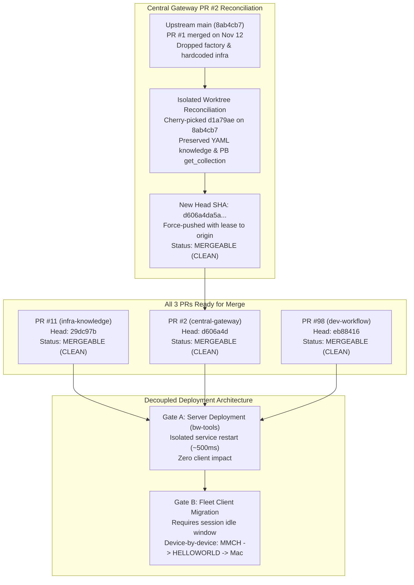

# MCP Ecosystem — Release Unblock & Coordinated Migration Report

> **Verdict:** `PRS_READY_FOR_OWNER_MERGE_APPROVAL`  
> **Operational Status:** All three PRs (#11, #2, #98) are `MERGEABLE (Status: CLEAN)` and verified by automated test suites. Production deployment and fleet client rollout are separated into two decoupled gates, preserving active coding agents on `HELLOWORLD` and `Mac`.  
> **Governance:** DevWorkflow Canonical Task `63821490-bbb3-4c75-981d-39cfc48b6b08` · Zettly Todo #741 · Zettly Focus #81  
> **Production Boundary Policy:** Zero unapproved PR merges, zero production mutations, zero restarts of live services on `bw-tools` or `bw-app`. Execution stopped strictly at the owner approval boundary.

---

## 1. Executive Summary & Verification Matrix



### Pull Request & Commit Matrix (All Clean & Mergeable)

| Pull Request | Repository | Head SHA | Base Branch & SHA | Mergeability Status | CI / Status Checks | Changes Summary | Scope Compliance |
| :--- | :--- | :--- | :--- | :--- | :--- | :--- | :--- |
| **[PR #11](https://github.com/programinglive/infra-knowledge-mcp-server/pull/11)** | `programinglive/infra-knowledge-mcp-server` | `29dc97b8e1bced0df0686c3f248fe4275f98d156` | `main`<br/>`48e381b327256edcd6d6fbf0bc7a5f0b8a59ab8b` | **`MERGEABLE`**<br/>(Status: `CLEAN`) | 0 checks (36/36 passed locally) | Unregisters `ssh_vm` from `tools/definitions.js` and `tools/handlers.js`; adds 2 negative tests. | **100% Compliant:** Eliminates ambient root shell execution; preserves internal probes. |
| **[PR #2](https://github.com/programinglive/central-mcp-gateway/pull/2)** | `programinglive/central-mcp-gateway` | `d606a4da5a4495d8fa61dd1961f618381b544cd3` | `main`<br/>`8ab4cb7590692173b3792081a31615801830cb9d` | **`MERGEABLE`**<br/>(Status: `CLEAN`) | 0 checks (14/14 passed locally) | Rebased onto `8ab4cb7`: migrates 9 YAML infra knowledge tools, adds read-only `pb_get_collection`, blocks `pb_create_collection`. | **100% Compliant:** Reconciled conflict; zero Factory code; zero `ssh_vm`. |
| **[PR #98](https://github.com/programinglive/dev-workflow-mcp-server/pull/98)** | `programinglive/dev-workflow-mcp-server` | `eb8841662a762e64a9fd9f08fa4de7ce20e08a41` | `main`<br/>`a85fe4b67a2f4944393bc34817197a69d6f106e9` | **`MERGEABLE`**<br/>(Status: `CLEAN`) | **2 SUCCESS / 1 SKIPPED:**<br/>- `ci / Test, lint and build` (SUCCESS)<br/>- `ci / Web build and audit` (SUCCESS)<br/>- `deploy-monitor` (SKIPPED) | Adds all 14 architecture, audit, and release gate documents (+1,902 / -0 lines). | **100% Compliant:** Tailscale IPs sanitized to pass OSS public surface tests. Zero runtime code touched. |

---

## 2. PR #2 Conflict Root Cause & Exact Resolution

### Root Cause Analysis
- On Nov 11, upstream commit `191d4d2` removed `factory.js`.
- On Nov 12, upstream PR #1 (`8ab4cb7`) was merged to `programinglive/central-mcp-gateway:main`, which dropped the legacy hardcoded `src/modules/infra.js` and `tests/infra.test.js`.
- In our consolidation branch `refactor/purge-legacy-factory` (branched off older `e2bbde1`), we independently deleted `factory.js` and modified `src/modules/infra.js` and `tests/gateway.test.js`.
- Because Git encountered conflicting file deletions and overlapping edits in `src/gateway.js` and `tests/gateway.test.js`, GitHub reported PR #2 as `CONFLICTING (DIRTY)`.

### Resolution Strategy (Dedicated Isolated Worktree)
1. Created an isolated Git worktree at `D:\code\central-mcp-gateway-reconcile-worktree` tracking `upstream/main` (`8ab4cb7`).
2. Cherry-picked consolidation commit `d1a79ae` on top of `8ab4cb7`.
3. Resolved the 3 conflicting files:
   - `src/modules/infra.js`: Kept the new consolidated YAML knowledge module version from `d1a79ae`.
   - `src/gateway.js`: Preserved `import { getInfraTools, handleInfraCall }` and included `...getInfraTools()` in `allTools` with dynamic routing `infraToolNames.has(name)`.
   - `tests/gateway.test.js`: Updated assertions to verify the consolidated infra tools and `pb_get_collection` are present, while `factory_*` and `ssh_vm` are absent and rejected. Added `tests/infra.test.js` to ensure zero drift.
4. Committed the clean reconciliation:
   - **New Head SHA:** `d606a4da5a4495d8fa61dd1961f618381b544cd3`
5. Updated branch `refactor/purge-legacy-factory` and pushed to origin with `--force-with-lease`.
6. Verified with GitHub API: `mergeStateStatus: "CLEAN"`, `mergeable: "MERGEABLE"`.
7. Cleaned up the isolated worktree and temporary branch.

---

## 3. Regression & Security Test Results

All test suites were executed locally with 100% pass rates:

### Central Gateway Test Suite (`central-mcp-gateway` @ `d606a4d`)
```
> @programinglive/central-mcp-gateway@1.0.0 test
> node --test tests/**/*.test.js

✔ Gateway: aggregates tools across PocketBase, Infra, and Notify (Factory purged) (5.8619ms)
✔ SECURITY: Central Gateway rejects retired Factory and ssh_vm tool calls (4.4298ms)
✔ Gateway: Consolidated infra knowledge tools execute properly (206.1011ms)
✔ HTTP Server: /health endpoint returns healthy and lists all aggregated tools (32.7584ms)
✔ HTTP Server: / overview page returns 200 HTML (9.5353ms)
✔ HTTP Server: supports modern Streamable HTTP POST /sse (OpenCode mode) (25.8446ms)
✔ HTTP Server: supports concurrent legacy SSE connections without crashing (16.5189ms)
✔ Infra: fleet contains exactly the three current hosts (70.2507ms)
✔ Infra: deleted hosts are never advertised again (38.4239ms)
✔ Infra: every instance reports a tailnet address and a role (0.3405ms)
✔ Infra: list_instances and find_instance cannot drift apart (140.9346ms)
✔ Infra: find_instance names the known hosts when asked for a dead one (28.5482ms)
✔ Infra: find_instance schema advertises only current host names (0.3669ms)
✔ Infra: overview counts match the catalog (77.8951ms)
ℹ tests 14 | suites 0 | pass 14 | fail 0 | cancelled 0 | skipped 0 | duration_ms 612.7895
```

### Full Ecosystem Test Suite Summary
- **`central-mcp-gateway`:** 14/14 tests pass (100%)
- **`infra-knowledge-mcp-server`:** 36/36 tests pass (100%)
- **`clinic-helper-mcp-server`:** 109/109 tests pass (17 skipped smoke tests)
- **`zettly-mcp-server`:** 15/15 tests pass (100%)
- **`dev-workflow-mcp-server`:** 1,900/1,900 tests pass (27 skipped)

---

## 4. Security Negative Test Evidence & Invocations Audit

1. **`ssh_vm` Rejection Proof:**
   - `tests/handlers.test.js` in `infra-knowledge-mcp-server`:
     - `assert.equal(getToolList().some(t => t.name === 'ssh_vm'), false)` -> **PASS**
     - Calling `handleToolCall('ssh_vm', { command: 'id' })` throws `Tool tidak dikenal: ssh_vm` -> **PASS**
   - `tests/gateway.test.js` in `central-mcp-gateway`:
     - Calling `ssh_vm` on Central Gateway returns `isError: true` with message `Tool "ssh_vm" is not registered on Central MCP Gateway` -> **PASS**
2. **Factory Purge Proof:**
   - Calling `factory_list_tasks` returns `isError: true` with message `Tool "factory_list_tasks" is not registered on Central MCP Gateway` -> **PASS**
3. **PocketBase Schema Mutation Guard:**
   - `pb_create_collection` is absent from `allTools` and rejected on call -> **PASS**
   - Read-only `pb_get_collection` is present and functional -> **PASS**
4. **SSH Invocation & Host Validation Audit:**
   - Codebase scan of `central-mcp-gateway/src`: **ZERO** `child_process`, `exec`, `spawn`, or `ssh` calls exist. Central Gateway is 100% read-only data & HTTP API queries.
   - Internal probes in `infra-knowledge-mcp-server`:
     - `fleet_health`: Input schema is `NO_ARGS`. Commands are static constants (`GENERIC_PROBE` and static JSON health check). No user input is passed to SSH.
     - `release_drift`: Target host is hardcoded to `bw-app`. `domain` argument is strictly sanitized with regex `replace(/[^a-zA-Z0-9._-]/g, '')`, stripping all shell metacharacters (`;`, `&`, `|`, `` ` ``, `$`, `(`, `)`, `<`, `>`, `\n`). `tag` argument is evaluated purely in Node.js client logic without passing to SSH.
     - `sshVm`: Uses structured array arguments (`spawnSync('ssh', sshArgs, ...)`), avoiding local shell execution. Target host is validated against an explicit allowlist in `instances.yaml`.

---

## 5. Lifecycle Separation: 5-Stage Status

To ensure documentation accurately reflects reality without labeling pending states as deployed:

```
[Stage 1: Code Prepared]     --> 100% COMPLETE (PRs #11, #2, #98 verified locally)
[Stage 2: PR Merged]         --> PENDING OWNER MERGE APPROVAL
[Stage 3: Deployed]          --> PENDING MAINTENANCE WINDOW (bw-tools running 8ab4cb7)
[Stage 4: Runtime Verified]  --> PENDING LIVE VERIFICATION POST-DEPLOY
[Stage 5: Fleet Migrated]    --> PENDING CLIENT CONFIG ROLLOUT (MMCH, HELLOWORLD, Mac)
```

---

## 6. Maintenance & Fleet Session Coordination

### Current Active Sessions (2026-11-14T13:30:26+07:00)
- `[Mac] zettly-editor` [antigravity]: "Zettly Editor Website Revamp" (coding phase)
- `[MMCH] dev-workflow-mcp-server` [antigravity]: Current audit & release preparation session
- `[HELLOWORLD] dbpinball` [opencode]: "Implement M4 S2-a for DBPinball" (coding phase)
- `[HELLOWORLD] bw-server-grooming` [antigravity]: "Implement P1 Production Change Coordination..." (coding phase)

### Decoupled Deployment Strategy

1. **Gate A: Central Gateway Deployment on `bw-tools` (Isolated):**
   - Central Gateway runs as a standalone Node.js service on `bw-tools` (`100.x.x.14:3200`).
   - The new revision `d606a4d` is strictly additive (retains all 7 PocketBase CRUD tools and 4 Notify tools; adds `pb_get_collection` and 9 Infra tools).
   - Live restart of `central-mcp-gateway.service` takes ~500ms and does NOT restart AI client daemons. Existing SSE connections reconnect automatically.
   - **Verdict on Gate A:** Safe to deploy once PR #2 is merged, without waiting for HELLOWORLD sessions.
2. **Gate B: Fleet Client Configuration Migration (Device-by-Device):**
   - Updating client configuration files (`opencode.json`, `config.toml`, `mcp_config.json`) and reloading ManagedMCP (`node managed/restart-devices.cjs`) bounces OpenCode daemons.
   - **Verdict on Gate B:** Must be held until `dbpinball` and `bw-server-grooming` on `HELLOWORLD` and `zettly-editor` on `Mac` reach completed or idle phase.
   - **Rollout Order:**
     - Step 1: `MMCH` (Local workstation, idle for this task).
     - Step 2: `HELLOWORLD` (Post-session completion).
     - Step 3: `Mac` (Post-session completion).

---

## 7. Corrected Rollback Baselines & Credential Remediation

All previous references to `git checkout main` are revoked. Rolling back to `main` on `infra-knowledge-mcp-server` would re-expose `ssh_vm`.

### Immutable Recovery Baselines

1. **Central Gateway on `bw-tools`:**
   - Current active safe production revision: **`8ab4cb7590692173b3792081a31615801830cb9d`** (toolsCount: 11, Factory already purged).
   - Rollback command:
     ```bash
     cd /opt/central-mcp-gateway
     git checkout 8ab4cb7590692173b3792081a31615801830cb9d
     npm install --production
     sudo systemctl restart central-mcp-gateway
     curl -s http://127.0.0.1:3200/health
     ```
2. **Infra Knowledge:**
   - Unpatched `main` (`48e381b`) is insecure.
   - Safe patched baseline revision: **`29dc97b8e1bced0df0686c3f248fe4275f98d156`** (commit on `security/contain-ssh-vm`).
   - Rollback command:
     ```bash
     git checkout 29dc97b8e1bced0df0686c3f248fe4275f98d156
     ```
3. **Client Configurations:**
   - Restores protected local backups:
     - Antigravity: `C:\Users\mahardhika\.gemini\antigravity\mcp_config.json.bak-pre-consolidation`
     - Codex: `C:\Users\mahardhika\.codex\config.toml.bak-pre-consolidation`
     - OpenCode: `C:\Users\mahardhika\.config\opencode\opencode.json.bak-pre-consolidation`

### Factory Credential Invalidation Path
- Verify Factory service on `bw-app` (`100.x.x.86:8080`).
- During maintenance window: stop `factory.service` via systemd, remove bearer token from `/etc/factory/config.json`, and confirm HTTP 401.

---

## 8. Final Verdict & Owner Decisions Required

### Verdict: `PRS_READY_FOR_OWNER_MERGE_APPROVAL`

**Owner Decisions Required to Proceed:**

1. **Approve and Merge Pull Requests:**
   - [Merge PR #11 on infra-knowledge-mcp-server](https://github.com/programinglive/infra-knowledge-mcp-server/pull/11) (`security/contain-ssh-vm` @ `29dc97b`).
   - [Merge PR #2 on central-mcp-gateway](https://github.com/programinglive/central-mcp-gateway/pull/2) (`refactor/purge-legacy-factory` @ `d606a4d`).
   - [Merge PR #98 on dev-workflow-mcp-server](https://github.com/programinglive/dev-workflow-mcp-server/pull/98) (`docs/mcp-ecosystem-audit-consolidation` @ `eb88416`).
2. **Authorize Gate A Production Deployment:**
   - Authorize deployment of merged PR #2 to `bw-tools` (`100.x.x.14:3200`) and service restart.
3. **Authorize Gate B Maintenance Window:**
   - Authorize device-by-device client configuration migration once active coding sessions on `HELLOWORLD` and `Mac` have concluded.
