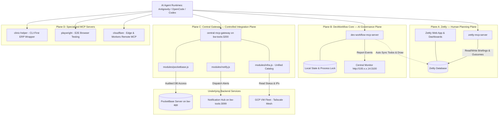

# MCP Target Architecture — Consolidated Ecosystem Specification

> **Status:** PROPOSED ARCHITECTURE  
> **Server Footprint:** Reduced from 9 connected servers to 6 focused, governed servers (-33%).  
> **Core Tenet:** Clear architectural planes, CLI-First domain logic, least-privilege security boundaries, and zero tool collision.

---

## 1. Target Architectural Planes

---

## 2. Server Boundary Definitions

### Plane A: Zettly — Human Planning Plane (`zettly`)
- **System of Record for:**
  - Human planning, daily todos, task priorities, and user notes.
  - Active focus containers (`focusId`).
  - Interactive visual diagrams (`Zettly Draw Studio`).
  - Daily activity outcome logs and journal entries.
- **Boundaries:** Zettly MCP provides high-level human planning tools (`zettly_work_briefing`, `zettly_recommend_next_work`, `zettly_record_work_outcome`). It does **not** govern code execution or git branching.

### Plane B: DevWorkflow Core — AI Governance Plane (`dev-workflow`)
- **System of Record for:**
  - AI task contracts, plans, and state machine lifecycle.
  - Definition of Done proofs and gate enforcement.
  - Branch protection, Git commit & push gates, and release locks.
  - Cross-device workflow synchronization (`ManagedMCP`).
- **Boundaries:** DevWorkflow acts as an automated API client to Zettly (syncing progress automatically), but leaves human task ownership and journal authoring to Plane A.

### Plane C: Central Gateway — Controlled Integration Plane (`central-gateway`)
- **System of Record for:**
  - Controlled PocketBase record access (`pb_*`).
  - Centralized notification dispatch (`notify_*` via Notification Hub).
  - Authoritative infrastructure fleet topology and health lookup (`infra_*`).
- **Boundaries:** Runs as a secured internal service on `bw-tools`. All database credentials and internal API tokens reside server-side, eliminating token distribution to developer laptops. Factory module is permanently purged.

### Plane D: Specialized MCP Servers
- **`clinic-helper`:** Preserved as a dedicated domain adapter for Beautyworld Clinic. Strictly follows the CLI-first rule: exposes headless PHP CLI commands with dry-run defaults, phrase confirmations, and tenant boundary enforcement.
- **`playwright`:** Preserved as the dedicated browser automation engine for E2E web testing and DOM inspection.
- **`cloudflare`:** Preserved as the dedicated remote edge cloud MCP for public DNS, Workers, KV, and R2 operations.

---

## 3. Consolidation & Decommissioning Summary

| MCP Server | Pre-Audit Status | Target Status | Replacement Workflow | Justification |
|---|---|---|---|---|
| `central-gateway` | Connected | **KEEP_WITH_REFACTOR** | Self (Refactored) | Purge `modules/factory.js`; integrate structured infra knowledge. |
| `dev-workflow` | Connected | **KEEP** | Self | Core AI governance engine; strictly compliant. |
| `zettly` | Connected | **KEEP** | Self | System of record for Human Planning Plane. |
| `clinic-helper` | Connected | **KEEP** | Self | Critical CLI-first adapter for Clinic ERP. |
| `playwright` | Connected | **KEEP** | Self | Official browser automation for E2E testing. |
| `cloudflare` | Connected | **KEEP** | Self | Official remote edge MCP for Cloudflare infrastructure. |
| `infra-knowledge` | Connected | **CONSOLIDATE** | Central Gateway (`modules/infra.js`) | Eliminate duplicate fleet tools. Remove hazardous `ssh_vm` from AI toolset. |
| `pocketbase` | Connected | **DISABLE** | Central Gateway (`modules/pocketbase.js`) | Eliminate 7 duplicate CRUD tools; centralize superuser credentials. |
| `mermaid` | Connected | **REMOVE** | Native Markdown + Zettly Draw Studio | Rendering base64 PNG via headless Chromium is obsolete and wasteful. |

**Net Result:** 9 Servers -> 6 Servers. Zero lost capabilities. Significant reduction in memory, token context, and security attack surface.
