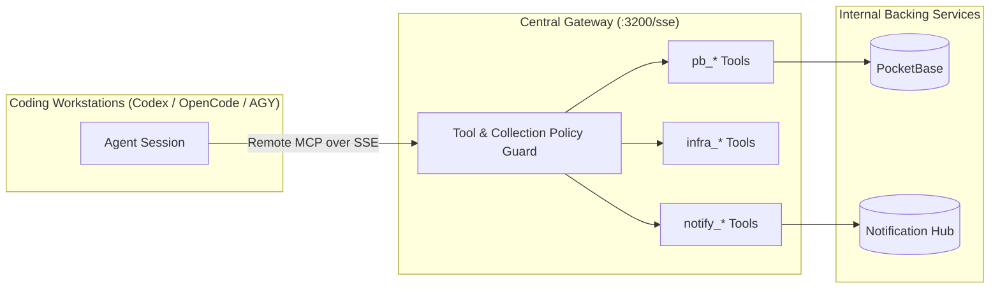

# Central Gateway MCP Architecture

**Document Version:** 1.0.0  
**Status:** Active Specification  

---

## 1. Overview

`central-gateway` is a remote Server-Sent Events (SSE) MCP server that aggregates shared infrastructure capabilities (`pb_*`, `infra_*`, `notify_*`) so coding agents across multiple workstations do not need local database SDKs or duplicated service credentials.

---

## 2. Registered `pb_*` Tools & Policy Classification

| Tool Name | Operation | Risk Level | Default Policy |
| :--- | :--- | :--- | :--- |
| `pb_health` | Read health | Low | Allow |
| `pb_list_collections` | Read metadata | Low | Allow (non-system collections) |
| `pb_get_collection` | Read schema | Low | Allow (non-system collections) |
| `pb_list_records` | Query records | Medium | Allow on permitted collections; filter validated |
| `pb_create_record` | Insert record | High | Require explicit collection allowlist |
| `pb_update_record` | Update record | High | Require explicit collection allowlist |
| `pb_create_collection` | Schema DDL | Critical | Deny by default for standard agent tasks |
| `pb_delete_record` | Delete record | Critical | Deny by default without explicit human authorization |

---

## 3. Trust Boundaries

1. **Restricted Collections:** `_superusers` and `activity_users` password/token fields are strictly protected from agent mutation via `pb_*` tools.
2. **Untrusted Content:** Records retrieved via `pb_list_records` are treated as untrusted external data and sanitized against prompt injection and secret leakage.
3. **Mobile Isolation:** The Android Companion never connects directly to `central-gateway`; it communicates exclusively with the DevWorkflow Monitor & Governance API using scoped device tokens.
