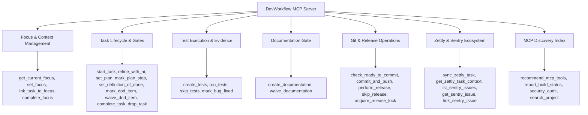

# DevWorkflow Architecture — Current State (As-Is Audit)

**Document Version:** 1.0.0  
**Audit Date:** 2026-11-12  
**Target Revision:** v1.30.0 (`565e381706c8`)  
**Auditor:** Principal Software Architect & AI Agent Infrastructure Engineer  

---

## 1. Executive Summary

DevWorkflow (`@programinglive/dev-workflow-mcp-server`) is an MCP-compliant (Model Context Protocol) server running on Node.js (>=20) designed to govern AI coding assistants (such as Antigravity CLI/IDE, OpenCode, and Codex) and human developers across distributed development workstations (`HELLOWORLD`, `Mac`, `MMCH`).

Currently, DevWorkflow enforces a strict sequential software development lifecycle:
$$\text{start\_task} \longrightarrow \text{flow\_gate} \longrightarrow \text{implement} \longrightarrow \text{tests} \longrightarrow \text{documentation} \longrightarrow \text{commit} \longrightarrow \text{release} \longrightarrow \text{complete}$$

It operates as a local daemon communicating via standard input/output (`stdio`) JSON-RPC, backed by a local SQLite database (`better-sqlite3`), and synchronizes real-time status with a centralized web monitor (`monitor-server` on `100.77.138.14:3100`) and a project management workspace (Zettly).

---

## 2. Repository Anatomy & Module Map

| Directory / File | Lines of Code (approx) | Single Responsibility |
|---|---|---|
| `index.js` | 366 | MCP entry point: server setup, Stdio transport, tool registration, request dispatch. |
| `workflow-state.js` | 2,766 | Core state machine, in-memory session cache, monotonic step flags, serialization. |
| `workflow-guidance.js` | 35 | Centralized prompt rules (`ENGLISH_IMPLEMENTATION_RULE`, `CLI_FIRST_RULE`, etc.). |
| `tools/definitions.js` | 1,135 | Schema definitions for 57 registered MCP tools. |
| `tools/handlers.js` | 260 | Top-level dispatcher routing tool requests to sub-modules. |
| `tools/handler-modules/` | ~3,500 | Domain handlers: `workflow-handlers.js`, `commit-handlers.js`, `test-handlers.js`, `docs.js`, `dod.js`, `plan.js`, `integration-handlers.js`. |
| `db/` | 1,800 | Storage abstraction: `schema.js`, `session-key.js`, `adapters/sqlite.js`, `postgres.js`, `mysql.js`. |
| `process-lock.js` | 348 | File-based lock mechanism (`mcp-process.lock`) preventing concurrent process corruption. |
| `security/` | 1,200 | Secret scanner, token sanitizer, output filter (`securityOutputFilter`), security audit. |
| `monitor-server/` | 4,200 | Express HTTP monitor dashboard (`dashboard.cjs`), build tracker, SSE events. |
| `managed/` | 2,100 | Fleet distribution: `rollout.cjs`, `release-server.cjs`, `restart-devices.cjs`, `protocol.cjs`. |
| `bin/cli.js` & `cli/` | 950 | Standalone CLI (`devwf`) for session dropping, completion, and monitor sharing. |
| `tests/` | 18,000+ | 130+ test suites containing 1,794 unit and integration tests (1,767 passing, 27 skipped). |

---

## 3. MCP Server & Registered Tool Catalog

The server registers **57 distinct tools** categorized across 7 capability domains:



### Request Flow
1. Client sends JSON-RPC 2.0 tool call via `stdio`.
2. `index.js` extracts session identity via `sessionKeyFromRequest(request)` and calls `workflowState.useSession(sessionId)`.
3. `workflowState.load()` reads current state from SQLite.
4. `tools/handlers.js` dispatches call to specific module.
5. If state mutated, `workflowState.save()` persists row with version increment.
6. Post-handler hook in `tools/handler-modules/index.js` asynchronously syncs with Zettly / Zettly Draw.
7. Outgoing response passes through `securityOutputFilter` (redacting credentials) and `withEnglishGuidance()` (injecting workflow reminders).

---

## 4. Task Lifecycle & State Machine Implementation

The workflow state is modeled in `workflow-state.js` around the following structure:

```json
{
  "currentPhase": "idle",
  "taskDescription": "Feature or bug description",
  "taskType": "feature | bugfix | refactor | chore",
  "projectDir": "D:/code/project-slug",
  "workflowTaskId": "canonical-task-id",
  "featureFlowCreated": true,
  "bugFixed": true,
  "testsCreated": true,
  "testsPassed": true,
  "testsSkipped": false,
  "documentationCreated": true,
  "documentationFiles": ["README.md"],
  "readyToCommit": true,
  "readyCheckCompleted": true,
  "commitAndPushCompleted": true,
  "released": true,
  "definitionOfDone": [
    { "id": "dod-1", "text": "CLI command verified", "status": "done", "evidence": "Output log..." }
  ],
  "plan": [
    { "id": "plan-1", "text": "Draft architecture", "status": "done" }
  ],
  "checkpoint": { "checkpointedAt": "...", "baseSha": "...", "commits": [] },
  "activeBuild": { "target": "...", "command": "...", "progress": 100, "buildHost": "bw-tools" }
}
```

### Monotonic Progression Flags
A key design pattern in `WorkflowState` is `MONOTONIC_STEP_FIELDS = ['featureFlowCreated', 'bugFixed', 'testsCreated', 'testsPassed', 'documentationCreated']`.
These flags can only transition from `false` to `true` during a single task execution, preventing accidental rollback of completed milestones when concurrent tool calls arrive. Quality gates (`readyToCommit`, `readyCheckCompleted`, `commitAndPushCompleted`, `released`) are intentionally non-monotonic: re-running tests or modifying code resets `readyToCommit` to `false`.

---

## 5. Persistence & Database Layer

- **Engine:** SQLite 3 via `better-sqlite3` as default local store; PostgreSQL and MySQL supported via adapter interface (`db/adapters/`).
- **Primary Schema:**
  - `workflow_state`: keyed by `(user_id, project_path, session_key)` with integer `version` for optimistic concurrency control.
  - `state_writer`: records active process PID, process token, and timestamp.
  - `state_writer_history`: append-only log of disk writes to detect multi-process contention.
  - `workflow_history`: permanent record of completed/dropped tasks.
  - `project_summary`: aggregate metrics per repository.
  - `sync_queue`: durable retry queue for outbound external synchronization (Zettly/webhooks).

---

## 6. Concurrency & Session Management

- **Coarse Repository Lock:** `process-lock.js` creates a file `mcp-process.lock` inside `.state/projects/<normalized-project-path>/`.
- **Heartbeat & Liveness:** The MCP process maintains an active heartbeat timestamp (`HEARTBEAT_MS = 60000`). If a process has not updated its lock file for >10 minutes, the lock is treated as stale.
- **Collision Handling:** If another living process holds the project lock, `start_task` rejects execution with an explicit Indonesian/English prompt requiring either `{ "force": true }` or closing the rival process.
- **Current Limitation:** Lock granularity is at the **project/repository level**, not per Git worktree. Two AI sessions cannot safely work on different branches of the same repository simultaneously.

---

## 7. Quality Gates & Governance Controls

1. **Mandatory Mermaid Flow Gate:** `start_task` requires a valid Mermaid flowchart (`flowchart TD` / `graph TD`). The system parses the flow, auto-creates an editable Zettly Draw canvas, and sets `featureFlowCreated = true`.
2. **CLI-First / Headless-First Architecture Standard:** Evaluated during `start_task` (advisory warning on `feature` tasks) and embedded into `MANAGED_RULE_BLOCK` across all fleet workstations.
3. **Red-Green-Refactor TDD Gate:** `run_tests` enforces that tests were executed and passed (`passed === true`). Failed tests block subsequent steps.
4. **Documentation Impact Gate:** `tools/handler-modules/docs.js` (`evaluateDocGate`) evaluates changed git files. If source code modified without documentation changes (`README.md`, `docs/`, `PRD.md`) or a valid recorded waiver (`MIN_WAIVER_REASON >= 10` characters), `check_ready_to_commit` rejects the transition.
5. **Conventional Commit & Release Lock:** Verifies `@programinglive/commiter` conventions and clean working trees before running `standard-version` tags.

---

## 8. Fleet Distribution & Multi-Machine Runtime

- **Release Topology:** Centralized release repository on `bw-tools` (`100.77.138.14:3101`).
- **Managed Bootstrap:** `managed/rollout.cjs` publishes reviewed tarballs to `bw-tools`, updates `device-entry.cjs` on `HELLOWORLD`, `Mac`, and `MMCH`, prewarms runtimes, and synchronizes `MANAGED_RULE_BLOCK` to `~/.gemini/GEMINI.md`, `~/.codex/AGENTS.md`, and `~/.config/opencode/AGENTS.md`.
- **Process Cycling:** `managed/restart-devices.cjs` signals stale daemon processes and invokes `managed/mcp-reconnect.cjs`.

---

## 9. Security Model & Sanitization

- `security/policy.js`: Enforces `DEV_WORKFLOW_SECURITY_MODE=strict`.
- `security/scanner.js`: Regex scanner detecting JWTs, private keys, database URLs, AWS/GCP tokens, bearer tokens.
- `security/sanitizer.js` (`securityOutputFilter`): Automatically redacts sensitive tokens from all outbound MCP tool responses before delivery to the client.
- `security_audit` tool: Scans local repository files, metadata, and database records for exposed plaintext secrets.

---

## 10. Automated Test Suite Metrics

- **Total Test Cases:** 1,794
- **Passed:** 1,767 (100% of non-skipped tests)
- **Failed:** 0
- **Skipped:** 27 (legacy database integration or optional network fixtures)
- **Execution Time:** ~24 seconds via Node.js native test runner (`node --import ./tests/setup-env.js --test`)
- **Key Test Suites:** `mandatory-flow-and-builder-host.test.js`, `rollout-rule-sync.test.cjs`, `workflow-english-guidance.test.js`, `docs-gate.test.js`, `process-lock.test.js`, `security.test.js`.

---

## 11. Existing Zettly First-Party Integration Architecture

DevWorkflow maintains an active first-party integration with **Zettly** (`https://github.com/programinglive/zettly`, running locally at `D:\code\zettly` and in production at `https://zettly.programinglive.com`):
- **Credential Storage:** `zettly-client.js` reads credentials from Windows DPAPI (`token.dpapi`), macOS Keychain (`programinglive.zettly`), or environment variables.
- **Todo & Progress Synchronization:** `zettly-workflow.js` tracks task state, DoD checklists, and completion outcomes using embedded HTML section markers (`<!-- dev-workflow:<id>:start -->`).
- **Visual Planning:** `zettly-drawing.js` parses Mermaid code into a valid TLDraw v4 document store and fractional index layout.
- **Zettelkasten Relations:** `zettly-tags.js` derives and synchronizes multi-axis tags (`project`, `type`, `area`, `source`).
- **Context Extraction:** `zettly-context.js` reads linked task graphs and dependency cycles to enrich AI context.
