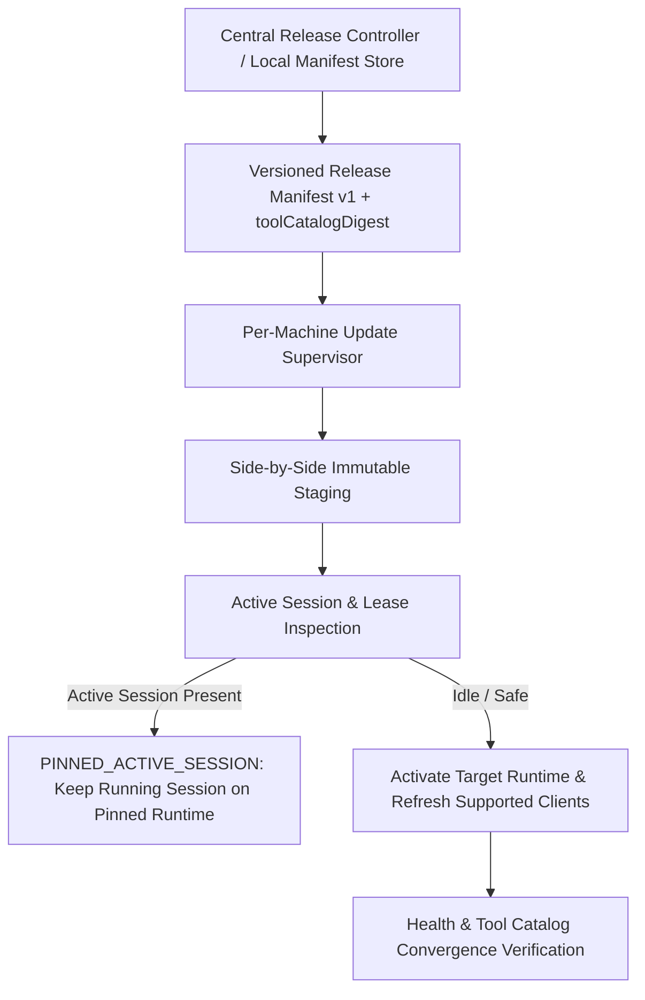

# DevWorkflow Fleet Update Architecture

## Overview

The DevWorkflow Automated Fleet Update Manager provides a zero-disruption, side-by-side runtime update and MCP tool synchronization pipeline across single-machine open-source installations and multi-machine development fleets.

## Core Architectural Principles

1. **Immutable Side-by-Side Runtime Staging:** Every release artifact (`<sha256>-<platform>-<arch>-<abi>`) is extracted and verified in its own isolated version directory. Active runtime files are never overwritten in place.
2. **Active vs. Installed Version Separation:** The supervisor tracks `installedVersion` (staged on disk), `runningVersion` (executing in live MCP processes), and `targetVersion` (approved release manifest) independently.
3. **Zero-Disruption Session Protection:** Active coding sessions (`coding`, `testing`, `release`) are never terminated during normal or automatic updates. New sessions resolve the newly staged runtime immediately while existing sessions remain pinned until completion.
4. **Explicit 6-Tier Authorization:** Checking (`fleet:check`), staging (`fleet:stage`), activating (`fleet:activate`), interrupting (`fleet:interrupt`), forced restart (`fleet:force_restart`), and publishing (`fleet:publish`) are separate permissions never granted to ordinary coding agent task tokens.
