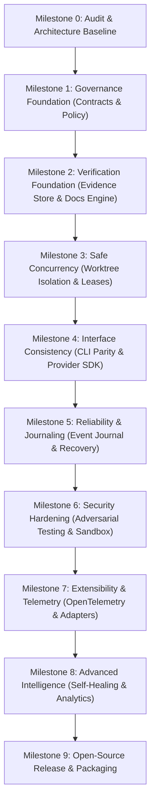

# DevWorkflow Architecture — Migration & Evolution Plan

**Document Version:** 1.0.0  
**Target Milestone Structure:** Milestones 0 through 9  
**Core Strategy:** Strangler Fig Pattern & Incremental Vertical Slices (Zero Greenfield Rewrite)  

---

## 1. Migration Strategy & Philosophy

To safeguard ongoing production development across the engineering fleet (`HELLOWORLD`, `Mac`, `MMCH`), this evolution follows the **Strangler Fig Pattern**:
1. **Never Break the Wire Protocol:** Existing MCP tool schemas (`start_task`, `run_tests`, `commit_and_push`) remain strictly functional throughout all phases.
2. **Dual-Read / Dual-Write Storage Evolution:** Existing SQLite tables (`workflow_state`, `workflow_history`) continue to be updated while new tables (`task_contracts`, `task_evidence`, `event_journal`) are introduced additively.
3. **Safe Fallbacks:** Any newly introduced subsystem (such as Policy-as-Code or Worktree Isolation) defaults to the existing battle-tested behavior unless explicitly enabled or configured.
4. **Independent Test Gates:** Every milestone must execute the full regression test suite (1,767+ tests) and add targeted contract tests before release.

---

## 2. Phased Milestone Roadmap

---

## 3. Milestone Execution Specifications

### Milestone 0: Repository Discovery & Architecture Baseline (COMPLETED)
- **Deliverables:**
  - `docs/architecture/current-state.md`
  - `docs/architecture/target-state.md`
  - `docs/architecture/gap-analysis.md`
  - `docs/architecture/migration-plan.md`
  - `docs/architecture/threat-model.md`
  - `docs/architecture/architecture-decisions.md`
- **Verification:** Empirical audit of 1,794 tests, 57 tools, database schema, and fleet runtime.

---

### Milestone 1: Governance Foundation (Task Contracts & Policy-as-Code)
- **Objectives:**
  - Introduce `TaskContract` class with JSON Schema validation (`contracts/task-contract.js`).
  - Introduce `PolicyEngine` supporting `devworkflow.yaml` (`policy/policy-engine.js`).
  - Add path scope drift validation (`contracts/scope-validator.js`).
- **Backward Compatibility:**
  - If `devworkflow.yaml` is absent, load default `Standard` profile.
  - If `start_task` receives legacy arguments, synthesize an implicit contract with permissive scope.
- **Verification Gate:**
  - Unit tests for contract schema validation.
  - Test scope-drift detection on unauthorized file mutations.

---

### Milestone 2: Verification Foundation (Evidence Store & Docs Impact Engine)
- **Objectives:**
  - Add `EvidenceStore` with SQLite table `task_evidence` (`evidence/evidence-store.js`).
  - Implement Git tree digest calculation and stale-evidence invalidation (`evidence/digest.js`).
  - Upgrade `tools/handler-modules/docs.js` to support impact-aware documentation rules.
- **Backward Compatibility:**
  - `run_tests` continues accepting boolean `passed` but now captures Git SHA and stdout digest.
  - Existing documentation waivers (`waive_documentation`) remain supported.
- **Verification Gate:**
  - Test verifying that modifying code after running tests invalidates evidence and blocks commit.
  - Test confirming docs-only commits pass without manual waiver.

---

### Milestone 3: Safe Concurrency (Worktree Isolation & Distributed Leases)
- **Objectives:**
  - Implement `WorktreeManager` managing `.worktrees/<task-id>` (`concurrency/worktree-manager.js`).
  - Implement `LeaseManager` with fencing tokens and lease expiration (`concurrency/lease-manager.js`).
  - Introduce serialized merge queue for shared resources (`concurrency/merge-queue.js`).
- **Backward Compatibility:**
  - Support `DEVWF_ISOLATION_MODE=directory|worktree` (defaulting to directory if worktrees are unsupported by host git).
- **Verification Gate:**
  - Concurrent agent execution test: two agents running simultaneously on different branches of the same repository.
  - Fencing token test: stale lease holder rejected from writing.

---

### Milestone 4: Interface Consistency (CLI Parity & Provider SDK)
- **Objectives:**
  - Expand `cli/` to support `devworkflow doctor`, `init`, `task start/plan/status/verify/evidence/pause/resume/cancel`.
  - Formalize Provider SDK interface: `TaskTrackerProvider`, `VisualFlowProvider`, `StorageProvider`.
  - Decouple Zettly into `providers/zettly/` and provide default `providers/local/`.
- **Backward Compatibility:**
  - `bin/cli.js` preserves legacy `devwf` command syntax and exit codes.
  - Existing Zettly setup remains active when configured.
- **Verification Gate:**
  - End-to-end task execution purely via CLI.
  - Zero-credential offline task execution test.

---

### Milestone 5: Reliability & Event Journaling
- **Objectives:**
  - Add `event_journal` table to SQLite schema.
  - Emit immutable events on every state transition, tool call, and policy evaluation.
  - Implement deterministic crash recovery replaying journal events.
- **Backward Compatibility:**
  - Additive database migration; legacy databases automatically upgrade.
- **Verification Gate:**
  - Fault injection test: process killed with `kill -9`, restarted, and verified to restore exact state.

---

### Milestone 6: Security Hardening & Adversarial Testing
- **Objectives:**
  - Implement threat-model mitigations (path traversal guards, symlink escape checks, argument escaping).
  - Add automated adversarial test suite attempting governance bypasses (stale evidence reuse, policy weakening, scope bypass).
  - Enforce explicit human approvals for critical operations.
- **Verification Gate:**
  - 100% pass on adversarial test suite.

---

### Milestone 7: Extensibility, Observability & Telemetry
- **Objectives:**
  - Implement OpenTelemetry event exporter for dashboard metrics.
  - Add reference GitHub Issues and Linear providers.
  - Modernize monitor dashboard to consume structured event streams.
- **Verification Gate:**
  - OpenTelemetry trace validation.

---

### Milestone 8: Advanced Intelligence & Bounded Self-Healing
- **Objectives:**
  - Implement risk-adaptive governance scoring.
  - Implement optional bounded self-healing test repair loop (disabled by default, strict retry/budget limits).
  - Implement context token optimization and compaction manifests.
- **Verification Gate:**
  - Bounded self-healing test verifying loop terminates on retry budget exhaustion.

---

### Milestone 9: Open-Source Release & Packaging
- **Objectives:**
  - Public documentation: `README.md`, `CONTRIBUTING.md`, `SECURITY.md`, `LICENSE`, `docs/quickstart/`.
  - Sanitize all internal hostnames, IPs, and private references.
  - Package standalone NPM distribution: `@devworkflow/core` and `devworkflow` CLI.
- **Verification Gate:**
  - Clean `npm pack` and offline quickstart execution in isolated sandbox.

---

## 4. Zettly First-Party Integration Roadmap (Milestones Z0 – Z6)

In alignment with the Supplementary Implementation Prompt, Zettly integration evolution proceeds in parallel with the core governance milestones:

| Integration Milestone | Focus Area | Aligned DevWorkflow Milestone | Key Deliverables |
|---|---|---|---|
| **Z0: Discovery & Contract** | Architecture Audit | Milestone 0 (Audit) | Audit `D:\code\zettly` API surface, publish `docs/integrations/zettly/integration-contract-v1.md`. |
| **Z1: Task Identity & Mapping** | Identity Mapping | Milestone 1 (Contracts) | Canonical UUID $\leftrightarrow$ Zettly Todo ID mapping, stable metadata schema, bidirectional provenance. |
| **Z2: Resilient Synchronization** | Transactional Outbox | Milestone 2 (Evidence) | Non-blocking outbox queue (`sync_queue`), failure isolation, loop prevention, exponential backoff. |
| **Z3: Governance Data Flow** | Policy & Evidence Sharing | Milestone 3 (Concurrency) | Display Task Contract scope, test evidence digests, and lease status in Zettly Todo section. |
| **Z4: Visual Planning Pipeline** | Structured Plan $\leftrightarrow$ Draw | Milestone 4 (SDK) | Two-way sync: Mermaid dependency graph $\leftrightarrow$ TLDraw v4 store schema; schema-validated visual edits. |
| **Z5: Human Control Plane** | Approvals & Reviews | Milestone 6 (Security) | Review queue in Zettly triggering cryptographic `Approval` records for production merge/release. |
| **Z6: Open-Source Documentation** | Official Integration Package | Milestone 9 (Release) | Standalone `@devworkflow/provider-zettly` package, installation guide, and local Docker integration fixture. |

---

## 5. Rollback & Disaster Recovery Procedures

1. **Database Schema Rollback:**
   - All migrations are additive. If a new version must be rolled back, legacy tables (`workflow_state`, `workflow_history`) remain intact and up-to-date due to dual-writing.
2. **MCP Process Rollback:**
   - Central release store on `build-host.example` retains all historical versions (`v1.29.9`, `v1.29.10`, `v1.30.0`).
   - `node managed/rollout.cjs --rollback <version>` rotates the pointer back in under 15 seconds.
3. **Workspace Emergency Cleanup:**
   - If an agent's worktree becomes corrupted, `devworkflow workspace cleanup --force` safely prunes isolated worktrees without touching the primary checkout.
