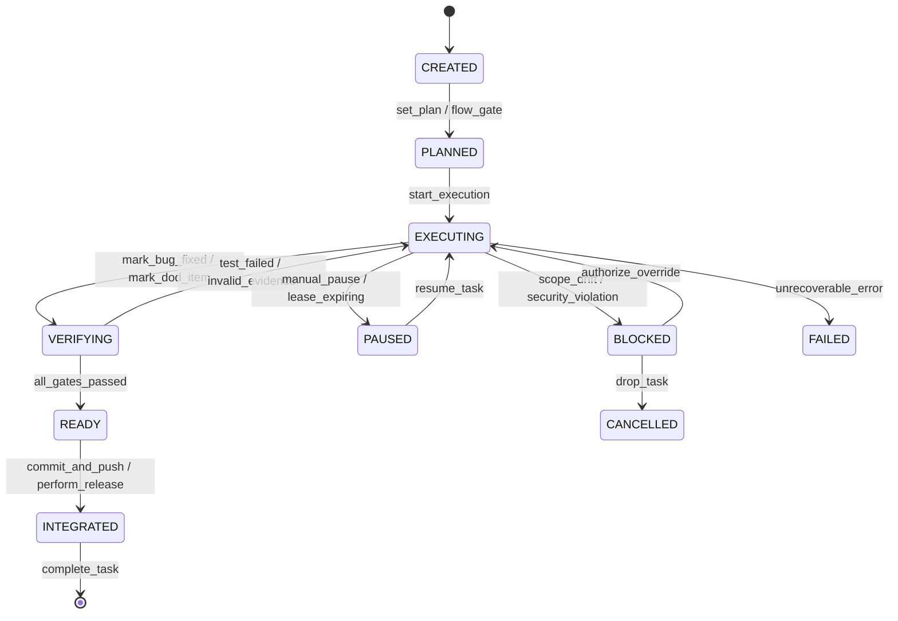

# DevWorkflow Architecture — Target State Specification

**Document Version:** 1.0.0  
**Target Positioning:** *DevWorkflow — The Governance Layer for AI Coding Agents*  
**Tagline:** *Let agents write code. Make every change accountable.*  

---

## 1. Architectural Vision & Principles

The target state evolves DevWorkflow from an internal MCP server into a **production-grade, agent-agnostic, policy-driven, verifiable AI software engineering runtime**.

### Guiding Principles
1. **CLI-First & Headless-First:** Every capability is executable in non-interactive terminal environments without requiring a browser or GUI.
2. **MCP-Native & Agent-Agnostic:** Operates transparently with any MCP-compliant coding agent (Antigravity, OpenCode, Codex, Claude Code, Cursor) without model-specific coupling.
3. **Local-First with Pluggable Cloud Sync:** Fully operational in offline air-gapped environments using local SQLite and Git, with extensible adapters for enterprise SaaS (GitHub, Linear, Zettly, Sentry).
4. **Policy-as-Code:** Governance rules are versioned, machine-readable declarative contracts (`devworkflow.yaml`).
5. **Evidence-Based Verification:** Tasks cannot complete based solely on AI assertions; every milestone requires verifiable, tamper-resistant evidence digests.
6. **Worktree Isolation & Safe Concurrency:** Parallel agents collaborate on the same repository in isolated Git worktrees governed by lease-based coordination and fencing tokens.

---

## 2. Target Layered Architecture (Ports & Adapters)

```text
                  +-----------------------------------------------+
                  |       AI Coding Agents & Human Developers      |
                  |  (Antigravity, OpenCode, Codex, Claude, CLI)  |
                  +-----------------------------------------------+
                                          |
                                          v
+---------------------------------------------------------------------------------+
|                                 ADAPTER LAYER                                   |
|   +--------------------+     +--------------------+     +-------------------+   |
|   |  MCP Stdio Server  |     |  devworkflow CLI   |     |  REST / SSE API   |   |
|   +--------------------+     +--------------------+     +-------------------+   |
+---------------------------------------------------------------------------------+
                                          |
                                          v
+---------------------------------------------------------------------------------+
|                           DEVWORKFLOW GOVERNANCE CORE                           |
|                                                                                 |
|   +-----------------------+   +-----------------------+   +-----------------+   |
|   | Task Contract Engine  |   | Policy-as-Code Engine |   |  State Machine  |   |
|   | - Schema Validation   |   | - devworkflow.yaml    |   |  - 6 Primary    |   |
|   | - Scope Drift Detect  |   | - Rule Precedence     |   |  - 4 Exceptional|   |
|   +-----------------------+   +-----------------------+   +-----------------+   |
|                                                                                 |
|   +-----------------------+   +-----------------------+   +-----------------+   |
|   | Evidence Store        |   | Lease & Concurrency   |   |  Event Journal  |   |
|   | - Digest Verification |   | - Worktree Isolation  |   |  - Append-Only  |   |
|   | - Stale Invalidation  |   | - Fencing Tokens      |   |  - Recovery     |   |
|   +-----------------------+   +-----------------------+   +-----------------+   |
|                                                                                 |
|   +-------------------------------------------------------------------------+   |
|   | Risk Classification Engine (Deterministic Path & Impact Matrix)          |   |
|   +-------------------------------------------------------------------------+   |
+---------------------------------------------------------------------------------+
                                          |
                                          v
+---------------------------------------------------------------------------------+
|                          EXECUTION & INTEGRATION LAYER                          |
|   +-------------------+  +-------------------+  +---------------------------+   |
|   | Worktree Manager  |  | Trusted Executor  |  | Quality Gates (TDD/Docs)  |   |
|   +-------------------+  +-------------------+  +---------------------------+   |
+---------------------------------------------------------------------------------+
                                          |
                                          v
+---------------------------------------------------------------------------------+
|                                 PROVIDER LAYER                                  |
|  +--------------------+  +--------------------+  +--------------------------+   |
|  | Task Tracker:      |  | Visualization:     |  | Persistence:             |   |
|  | - Builtin / Local  |  | - Mermaid CLI/SVG  |  | - SQLite (Default)       |   |
|  | - GitHub / Linear  |  | - Zettly Draw      |  | - PostgreSQL / MySQL     |   |
|  | - Zettly           |  | - Excalidraw       |  |                          |   |
|  +--------------------+  +--------------------+  +--------------------------+   |
|  +--------------------+  +--------------------+  +--------------------------+   |
|  | Observability:     |  | Approvals:         |  | Execution Environment:   |   |
|  | - Fleet Monitor    |  | - CLI / Webhook    |  | - Local Shell            |   |
|  | - OpenTelemetry    |  | - GitHub Review    |  | - Docker Sandbox         |   |
|  +--------------------+  +--------------------+  +--------------------------+   |
+---------------------------------------------------------------------------------+
```

---

## 3. Core Subsystem Specifications

### 3.1 Task Contract Engine
Every task is governed by a machine-readable, schema-validated JSON/YAML Task Contract:
- **Contract Schema:**
  - `taskId`: Canonical UUID/CUID.
  - `repo`: Repository URI and root path.
  - `intent`: Plain text problem statement.
  - `scope`:
    - `allowedPaths`: Glob patterns permitted for mutation.
    - `forbiddenPaths`: Glob patterns strictly protected from writes.
  - `risk`: `LOW | MEDIUM | HIGH | CRITICAL`.
  - `acceptanceCriteria`: Array of verifiable assertions.
  - `definitionOfDone`: Discrete checklist with evidence bindings.
  - `policyDigest`: SHA-256 hash of active `devworkflow.yaml`.
  - `workspace`: Assigned Git worktree path and lease token.
- **Scope Drift Detection:** Detects untracked file additions or edits outside `allowedPaths`. Violations trigger an immediate policy pause rather than silent acceptance.

### 3.2 Policy-as-Code Engine (`devworkflow.yaml`)
A versioned declarative configuration file placed in the repository root:
```yaml
version: "1"
profile: "standard" # lightweight | standard | critical

overrides:
  - match: "src/auth/**"
    profile: "critical"
    approvals: ["security-team"]
  - match: "docs/**"
    profile: "lightweight"
    testing: false

profiles:
  lightweight:
    testing: false
    docGate: false
    approvals: 0
  standard:
    testing: true
    minCoverageDelta: 0
    docGate: true
    approvals: 0
  critical:
    testing: true
    securityScan: true
    docGate: true
    approvals: 1
    deploymentGuard: "blue-green"
```

### 3.3 Strict State Machine & Lifecycle Transitions
Replaces ad-hoc string phases with a formal state machine:



Guards evaluate transition validity: an agent cannot jump from `EXECUTING` to `READY` without satisfying all intermediate verification checks.

### 3.4 Evidence Store & Verification Engine
Replaces simple boolean flags (`testsPassed: true`) with structured, verifiable evidence objects:
- **Evidence Record:**
  - `executionId`: Unique execution run identifier.
  - `gitTreeSha`: SHA of Git tree at the moment of execution.
  - `command`: Full command line executed.
  - `runner`: `local-trusted | docker | remote-runner`.
  - `exitCode`: Integer process exit code.
  - `testSummary`: Total, passed, failed, skipped counts.
  - `stdoutDigest`: SHA-256 hash of sanitized console output.
  - `timestamp`: Start and completion ISO-8601 timestamps.
  - `status`: `VERIFIED | REJECTED | STALE`.
- **Stale Evidence Detection:** Modifying any file in the workspace automatically invalidates previous test evidence.

### 3.5 Worktree Isolation & Lease Coordination
Evolves single-process repository locking into safe multi-agent concurrency:
- **Workspace Isolation:** Every eligible task is assigned its own Git worktree (`.worktrees/<task-slug>`).
- **Distributed Leases:** State records lease ownership with fencing tokens (`leaseEpoch`).
- **Fencing:** Out-of-date agents with stale lease tokens are rejected by storage and git operations.
- **Shared Resource Guards:** Serializes integration when touching database migrations (`migrations/`) or deployment configuration.

### 3.6 Pluggable Provider Architecture
Extensible driver interfaces with clear boundaries:
- `TaskTrackerProvider`: `LocalProvider` (default), `GitHubIssuesProvider`, `LinearProvider`, `ZettlyProvider`.
- `VisualFlowProvider`: `MermaidCliProvider` (default local SVG), `ExcalidrawProvider`, `ZettlyDrawProvider`.
- `StorageProvider`: `SQLiteProvider` (default), `PostgreSQLProvider`, `MySQLProvider`.
- `ObservabilityProvider`: `DashboardProvider` (local HTTP), `OpenTelemetryProvider`.
- `ApprovalProvider`: `InteractiveCliProvider`, `WebhookApprovalProvider`, `GitHubReviewProvider`.

---

## 4. Enhanced CLI Interface (`devworkflow`)

Expands `devwf` into a first-class engineering companion:

```bash
# Inspection and setup
devworkflow doctor                     # Diagnostic check of tools, git, node, storage
devworkflow init                       # Initialize devworkflow.yaml in repository

# Task Lifecycle
devworkflow task start <desc> [flags]  # Start task, acquire lease, allocate worktree
devworkflow task plan <steps...>       # Set or update execution plan
devworkflow task status                # Show lifecycle phase, gates, active lease
devworkflow task verify                # Execute quality checks and collect evidence
devworkflow task evidence              # View verified evidence records
devworkflow task pause                 # Release lease temporarily
devworkflow task resume <id>           # Reacquire lease and resume worktree
devworkflow task cancel <id>           # Drop task and clean workspace

# Governance & Policies
devworkflow policy check               # Evaluate repository changes against devworkflow.yaml

# Workspace & Concurrency
devworkflow workspace list             # Show active worktrees and lease owners
devworkflow workspace cleanup          # Prune merged, idle worktrees

# Providers & Auditing
devworkflow provider list              # Show registered plugins and active drivers
devworkflow events                     # Tail append-only event journal
```
