# DevWorkflow Android Companion — Milestones M0–M9 Execution Roadmap

**Document Reference:** `DEVWF-MOB-ROADMAP-001`  
**Date:** 2026-11-12  
**Target Device:** Xiaomi Pad 6 Optimized · Universal APK · Open-Source Ready  

---

## Roadmap Overview

```mermaid
flowchart LR
  M0["M0: Audit & Baseline"] --> M1["M1: Runtime Server Config"]
  M1 --> M2["M2: Cryptographic Pairing"]
  M2 --> M3["M3: Real-Time SSE Transport"]
  M3 --> M4["M4: Xiaomi Pad 6 Cockpit"]
  M4 --> M5["M5: Governance Backend API"]
  M5 --> M6["M6: Interactive Mobile Governance"]
  M6 --> M7["M7: Automated APK CI/CD"]
  M7 --> M8["M8: Security & Reliability"]
  M8 --> M9["M9: Universal Open-Source RC"]
```

---

## Detailed Milestone Definitions

### Milestone M0: Existing Application Audit & Baseline (COMPLETED)
- [x] Complete code audit of `mobile-app/` (`App.js`, `app.json`, `build-view.js`, `flow-relation.js`).
- [x] Audit of `monitor-server/dashboard.cjs` routes and database queries.
- [x] Verification of baseline test suite (28 monitor tests + 6 mobile tests green).
- [x] Authored architectural audit (`current-state-audit.md`), gap analysis (`gap-analysis.md`), target architecture (`target-architecture.md`), Xiaomi Pad 6 hardware specification (`xiaomi-pad-6-optimization.md`), and threat model (`security-threat-model.md`).

### Milestone M1: Dynamic Runtime Server Configuration
- [ ] Decouple `MONITOR_URL` from build-time constants.
- [ ] Implement `ServerProfileStore` using encrypted persistent storage.
- [ ] Add runtime Server Selection & Setup Screen in `mobile-app/`.
- [ ] Support manual IP/domain entry with protocol validation (`http://` vs `https://`).
- [ ] Provide connection health testing before saving profile.
- [ ] Unit tests for server URL normalization, profile switching, and migration of legacy settings.

### Milestone M2: Secure Cryptographic Device Pairing
- [ ] CLI command: `devworkflow monitor pair` (or `devwf monitor pair`).
- [ ] Single-use ephemeral pairing challenge generator with 3-minute TTL.
- [ ] Terminal QR code rendering using `qrcode-terminal`.
- [ ] Mobile QR Scanner screen using `expo-camera` or `react-native-vision-camera`.
- [ ] Device ECDSA keypair generation in Android Keystore.
- [ ] Mutual confirmation handshake in developer terminal.
- [ ] Secure token issuance and storage in `EncryptedSharedPreferences`.
- [ ] Device revocation CLI command: `devworkflow monitor revoke <device-id>`.

### Milestone M3: Real-Time Event Streaming (SSE + Snapshot)
- [ ] Implement `/api/v1/mobile/snapshot` endpoint on monitor server.
- [ ] Implement `/api/v1/mobile/events` Server-Sent Events router with `Last-Event-ID` cursor.
- [ ] Coordinated `ConnectionManager` in React Native:
  - Foreground: Persistent SSE socket with automatic reconnection backoff.
  - Background: Clean disconnection to preserve battery.
  - Resumption: Snapshot fetch + cursor replay.
- [ ] Polling fallback if SSE connection fails repeatedly (3 attempts).
- [ ] Connectivity status indicator in UI (`LIVE`, `RECONNECTING`, `OFFLINE`).

### Milestone M4: Xiaomi Pad 6 Cockpit UX Optimization
- [ ] Implement 3 distinct interface modes:
  - **Cockpit Mode:** Dense passive overview, KPI strip, live build stepper, 2-column active cards.
  - **Focus Mode:** Deep task inspection, pinch-to-zoom architecture diagram viewer, full DoD checklist.
  - **Governance Mode:** Contextual review sheet for pending human gates.
- [ ] Virtualized activity stream using `FlatList` with bounded event buffer.
- [ ] Inactivity ambient dimming for extended desk operation.
- [ ] Touch target audit (minimum 48×48 dp).
- [ ] Verified physical test on Xiaomi Pad 6.

### Milestone M5: Governance Backend & Supervision Core
- [ ] Add `/api/v1/mobile/governance/action` endpoint.
- [ ] Verify device signature, task contract revision, and evidence digest before executing transitions.
- [ ] Support actions: `approve_plan`, `reject_plan`, `approve_commit`, `waive_gate`.
- [ ] Implement 4-stage Emergency Stop supervisor protocol (`STOP_REQUESTED` → `STOP_CONFIRMED`).
- [ ] Immutable audit logging in `events` table for all mobile governance actions.

### Milestone M6: Interactive Mobile Governance UI
- [ ] Interactive Action Bar in `DetailSesi` modal.
- [ ] Diffs and changed files summary view before commit approval.
- [ ] Step-up confirmation modal for sensitive/destructive operations (`Emergency Stop`, `Waive Gate`).
- [ ] Optimistic UI prevention: action buttons show loading spinners and only resolve upon verified backend response.

### Milestone M7: Automated CI/CD & Signed APK Release Pipeline
- [ ] GitHub Actions workflow `.github/workflows/mobile-release.yml`.
- [ ] Clean build container with JDK 17, Android SDK 34/35, Gradle 8.x.
- [ ] Linting, type-checking, and test execution before build.
- [ ] Automated Gradle release compilation (`assembleRelease`).
- [ ] Signature verification and SHA-256 checksum generation (`SHA256SUMS.txt`).
- [ ] Draft GitHub Release artifact creation on git tag push (`v*.*.*-mobile`).

### Milestone M8: Security, Adversarial & Reliability Testing
- [ ] Adversarial test suite: expired pairing challenge, tampered signature, unauthorized action, replay attack.
- [ ] Network interruption tests: abrupt Wi-Fi disconnection, airplane mode toggle, server restart recovery.
- [ ] Stress test: high-frequency event stream (100 events/second) without mobile UI freezing or OOM.
- [ ] Physical device verification on Xiaomi Pad 6 with battery and thermal logging.

### Milestone M9: Universal Open-Source Release Candidate
- [ ] Remove all hardcoded company IP addresses and hostnames from `mobile-app/`.
- [ ] Author user guide: `docs/mobile/user-guide.md` (pairing, desk cockpit setup, troubleshooting).
- [ ] Provide developer guide: `docs/mobile/developer-guide.md` (local build, emulator setup, ADB commands).
- [ ] Publish standalone Release Candidate APK.
