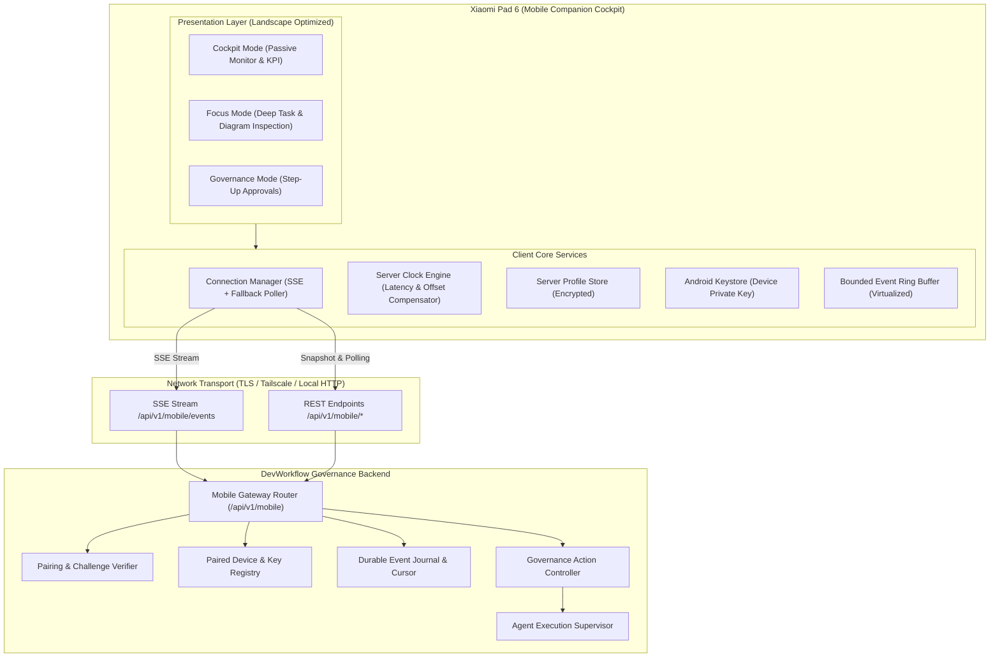

# DevWorkflow Android Companion — Target Architecture Specification

**Document Reference:** `DEVWF-MOB-ARCH-001`  
**Date:** 2026-11-12  
**Target Hardware:** Xiaomi Pad 6 (Desk Cockpit Mode, Landscape)  
**Security Level:** Enterprise Grade / Open-Source Ready  

---

## 1. Architectural Philosophy

The Android Companion is an **inspection cockpit and human governance gate**, NOT a duplicate business logic engine.

### Non-Negotiable Core Principles:
1. **Never Duplicate Governance:** All state machine transitions, policy evaluations, and git actions occur exclusively on the DevWorkflow core server.
2. **Server-Driven Truth:** The client displays what the server reports. Timestamps, durations, build status, and task states are strictly server-synchronized.
3. **Graceful Transport Degradation:** SSE is primary; if proxies or firewalls strip streaming, automatically fall back to adaptive REST polling without user disruption.
4. **Zero-Trust Device Authorization:** Network access to the monitor port does not grant write or governance privileges. Mutual cryptographic pairing is mandatory for approvals and cancellations.

---

## 2. System Architecture Diagram



---

## 3. Layered Design

### Layer 1: Presentation (Cockpit UX)
- **Cockpit Mode:** High-density, passive overview. Displays active agent cards, KPI strip (active sessions, pending approvals, failed builds), live build pipeline stepper, and running duration counter.
- **Focus Mode:** Opened by tapping any card. Full-screen architecture viewer (Mermaid / Zettly Draw rasterizer with pinch-to-zoom), complete plan steps, Definition of Done status, changed files diff summary, and live activity stream.
- **Governance Mode:** Contextual review sheet presented when an agent hits a policy gate (e.g. `check_ready_to_commit` or plan refinement). Displays risk classification, test execution evidence, scope diff, and interactive action buttons (`Approve`, `Reject`, `Waive`, `Emergency Stop`).

### Layer 2: Transport & Lifecycle Management
- **`ConnectionManager`:** Manages foreground/background transitions.
  - When app is in foreground: Establishes SSE stream with `Last-Event-ID` header.
  - When app transitions to background: Closes persistent SSE socket cleanly to prevent battery drain; sets a low-frequency wake timer if notifications are enabled.
  - On network reconnection: Re-requests snapshot and replays missed events from the cursor. If the cursor has expired on the server, gracefully resets the local state with a full snapshot.
- **`ServerClockEngine`:** Calculates round-trip time ($RTT$) on each request:
  $$\Delta_{offset} = T_{server} - (T_{send} + \frac{RTT}{2})$$
  Ensures all session age and timer displays are monotonic and aligned with the server clock regardless of local tablet clock drift.

### Layer 3: Security & Cryptographic Pairing
- **Device Identity:** The tablet generates an ECDSA keypair ($P_{256}$) inside the Android Keystore.
- **Pairing Protocol:**
  1. Developer runs `devworkflow monitor pair` in the terminal.
  2. Server generates single-use random nonce and renders QR code:
     `devwf://pair?v=1&url=https://127.0.0.1:3100&nonce=<NONCE>&fp=<SERVER_FINGERPRINT>`
  3. Tablet camera scans QR code, generates local device identity, signs challenge with private key:
     `POST /api/v1/mobile/pair/verify` `{ nonce, deviceName: "Xiaomi Pad 6", pubKey }`
  4. Server terminal prompts developer: `"Authorize device 'Xiaomi Pad 6' with fingerprint a8f3...? [y/N]"`.
  5. Developer confirms. Server saves public key to `paired_devices` SQLite table and issues an expiring refresh token.
  6. Tablet receives and securely stores token in Android Keystore / EncryptedSharedPreferences.
  7. Future governance actions are signed with the device private key.

---

## 4. REST & Streaming API Contracts

### 4.1. `POST /api/v1/mobile/pair` (Pairing Verification)
- **Request:**
  ```json
  {
    "nonce": "ch_7f39a82b",
    "deviceName": "Xiaomi Pad 6 (Office Desk)",
    "clientPublicKey": "-----BEGIN PUBLIC KEY-----\n...",
    "signature": "base64_signature_of_nonce"
  }
  ```
- **Response:**
  ```json
  {
    "ok": true,
    "status": "pending_human_confirmation",
    "verificationCode": "481-920"
  }
  ```

### 4.2. `GET /api/v1/mobile/events` (Server-Sent Events)
- **Headers:** `Accept: text/event-stream`, `Last-Event-ID: 10482`, `Authorization: Bearer <DEVICE_TOKEN>`
- **Stream Format:**
  ```text
  id: 10483
  event: session_update
  data: {"sessionKey":"ses_123","state":"live","phase":"coding","plan_done":2,"plan_total":4}

  id: 10484
  event: build_progress
  data: {"sessionKey":"ses_123","target":"APK Release","progress":65,"stage":"Compiling C++"}

  : heartbeat 2026-11-12T12:50:00Z
  ```

### 4.3. `POST /api/v1/mobile/governance/action`
- **Request:**
  ```json
  {
    "action": "approve_commit",
    "sessionKey": "ses_123",
    "taskId": "task-482",
    "contractRevision": 3,
    "expectedEvidenceSha": "e3b0c44298fc1c149afbf4c8996fb92427ae41e4649b934ca495991b7852b855",
    "timestamp": "2026-11-12T12:50:02Z",
    "signature": "base64_signature_of_payload"
  }
  ```
- **Response:**
  ```json
  {
    "ok": true,
    "recordedAt": "2026-11-12T12:50:02.104Z",
    "stateTransition": {"from": "reviewing", "to": "ready_to_commit"},
    "auditId": "aud_89102"
  }
  ```

### 4.4. `POST /api/v1/mobile/governance/emergency-stop`
- **Request:**
  ```json
  {
    "sessionKey": "ses_123",
    "reason": "Agent modifying files outside task scope",
    "forceKill": true,
    "timestamp": "2026-11-12T12:50:05Z",
    "signature": "base64_signature"
  }
  ```
- **Response:**
  ```json
  {
    "ok": true,
    "status": "STOP_DISPATCHED",
    "host": "HELLOWORLD",
    "supervisorStatus": "SIGNAL_SENT"
  }
  ```
