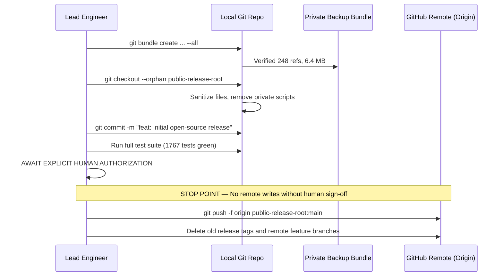

# Clean History Strategy & In-Place GitHub Reinitialization

**Document Version:** 1.0.0  
**Target:** Reinitialize `origin/main` in-place with a clean orphan root commit  
**Precondition:** Complete offline private backup verified (`<PRIVATE_BACKUP_PATH>`)  

---

## 1. Technical Execution Protocol

To completely erase sensitive historical commits while preserving the GitHub repository URL, stars, watchers, and issue discussions:

---

## 2. GitHub-Specific Cleanup Requirements

Replacing the default branch is step 1. Step 2 requires eliminating lingering historical objects on GitHub:

1. **Delete Remote Stale Branches:**
   - Remove historical remote branches (`remotes/origin/chore/*`, `remotes/origin/docs/*`, `remotes/origin/fix/*`).
   - Run: `git push origin --delete <branch-name>`.
2. **Delete Legacy Tags:**
   - Legacy tags (`v1.0.0` through `v1.30.0`) point directly to historical internal commits.
   - Delete all remote tags: `git tag -l | ForEach-Object { git push origin --delete $_ }`.
   - Re-tag the clean orphan root commit as `v1.0.0-oss`.
3. **Delete Stale GitHub Releases & Assets:**
   - Remove existing releases from the GitHub Releases UI or CLI (`gh release delete`).
4. **Purge GitHub Pull Request & Commit Caches:**
   - Cached commit objects may remain accessible via direct SHA URL (`/commit/<sha>`) until GitHub runs garbage collection.
   - For complete purge of sensitive commit hashes from GitHub internal caches, open a ticket with GitHub Support requesting repository garbage collection (`git gc --prune=now`).
5. **Credential Revocation & Rotation:**
   - Any historical credential, API token, or SSH key that was ever committed to the repository must be treated as compromised and rotated immediately, regardless of history deletion.
